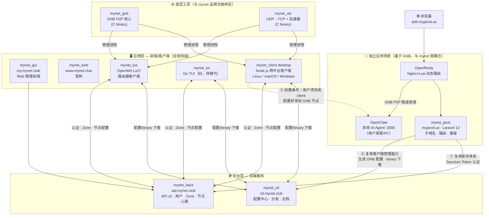

# MyNet CTL（控制分发中心）— Copilot 指南

本仓库是 **mynet.club 站点软件分发中心**，基于 Laravel 12 / PHP 8.2。

## 📚 生态系统知识库

本项目维护 MyNet 生态系统的 **SSOT 知识库**，位于 `docs/knowledge-base/`：
- [ecosystem.md](../docs/knowledge-base/ecosystem.md) — 10 个子项目全景、技术栈、域名、关系图
- [architecture.md](../docs/knowledge-base/architecture.md) — 系统架构、数据流、认证、分发协议
- [conventions.md](../docs/knowledge-base/conventions.md) — 统一规范、平台矩阵、API 版本、目录结构
- [projects/](../docs/knowledge-base/projects/) — 各子项目速查卡

> **开发前请先查阅知识库**，确保理解项目间关系和约定。修改涉及跨项目契约时，同步更新知识库。

## 🌐 多项目生态总览

### 产品定位层次



| 项目 | 域名 | 技术栈 | 角色 |
|------|------|--------|------|
| mynet_back | admin.mynet.club / api.mynet.club | Laravel 12 | mynet 组网服务后端：用户/Zone/节点/VPN 配置管理 |
| mynet_gui | my.mynet.club | Quasar/Vue3 | mynet 组网服务 Web 前端 |
| mynet_ctl | ctl.mynet.club | Laravel 12（本项目）| 软件分发中心（binary/脚本/配置）|
| mynet_web | www.mynet.club | 静态/CMS | 落地页 |
| mynet_tui | 本地部署 | Go binary（→ 将迁移至 Node.js）| GNB/UTC 客户端配置工具 CLI/TUI |
| mynet_lua | 本地部署 | Lua/LuCI | OpenWrt 路由器版 GNB 配置工具（LuCI Web UI）|
| mynet_utc | 依赖 CTL | C binary | UDP→TCP 隧道转换器 + 加速器 |
| mynet_gnb | 无域名 | C binary | GNB P2P 组网核心，由 CTL 分发 |
| mynet_javis | myjarvis.ai | Laravel 12 | GNB 独立应用场景：个人 AI 穿透服务（与 mynet 弱耦合）|
| download.mynet.club | 遗留 | 静态文件 | 已禁止目录访问 |

---

### mynet_back 核心功能（mynet 组网服务后端）
- 用户注册/登录（Sanctum Token）、Zone 管理、节点管理、节点密钥（Ed25519）
- 节点心跳上报（签名验证，节点主动 POST）
- 为 client/lua 提供：认证、Zone 列表、节点配置、路由配置
- mynet 有一定**社交属性**：用户可创建 Zone 邀请他人加入，共享 GNB 组网

### mynet_tui（→ mynet_client desktop 包）
- Go 语言，跨平台 CLI + TUI 界面（基于 tview/tcell）
- 功能：登录/登出、Zone 切换、节点配置同步、GNB 进程启停、状态监控
- 从 CTL 拉取最新 gnb/utc binary，从 mynet_back 拉取 Zone/Node 配置
- **计划**：Go → Node.js 重写

### mynet_lua（→ mynet_client openwrt 包）
- Lua/LuCI，OpenWrt 路由器专用（路由器跑不了 Go/Node.js）
- 功能与 tui 完全对应：登录、Zone、节点、配置同步、VPN 启停、状态监控
- 通过 LuCI Web 界面操作，与 mynet_back API 通信（curl）

### mynet_javis（GNB 的一种独立应用场景）
**myjarvis.ai** — 基于 GNB P2P 穿透技术的个人 AI 服务，是 GNB 能力的一种**具体商业场景**。

**与 mynet 的关系（重要）：**
- mynet_javis 本质上是**独立产品**，与 mynet 组网服务弱耦合
- **复用账号体系**：账号复用 mynet_back（Sanctum Token），免去重复注册
- **复用客户端管理能力**：通过 CTL 生成/下载 GNB 配置；用户用 mynet_client 管理 GNB 节点，这个节点就是 javis 的穿透终端
- 它用的是 GNB 底层穿透能力，而不是 mynet 的组网服务本身

**完整层级：**
```
mynet_client          ← 配置工具：用户用它管理本地 GNB 节点（必须先配好 GNB）
    ↓ 启动/管理
mynet_gnb             ← 传输层：GNB P2P 隧道
    ↓ 提供穿透能力
mynet_javis（服务端） ← 应用层：GNB 穿透的一种场景（个人 AI 穿透）
```

**访问链路：**
```
浏览器 → arthur.myjarvis.ai
         ↓ OpenResty（Nginx+Lua 动态路由）
         ↓ GNB P2P 隧道（用户用 client 配置好的 GNB 节点）
         用户家里/PC 上的 OpenClaw（本地 AI Agent = Jarvis）
```

- 用户先用 **mynet_client** 在本地配置好 GNB 节点
- 在 myjarvis.ai 注册子域名（如 `arthur.myjarvis.ai`）
- 用户 PC 的 GNB 节点定时发心跳上报 IP（Ed25519 签名）
- OpenResty Lua 脚本动态路由：shared dict 5s TTL → Redis → Laravel API
- 质量门限：低网络质量节点自动降级
- 两种套餐：托管版（¥39/年，Jarvis 提供入口节点）、自托管版（免费，用户自备云服务器）
- **OpenClaw** = 本地 AI 助手（即「Jarvis AI」），监听 :3000，由 GNB 隧道对外暴露

---

### 🔮 计划中：mynet_client（合并 mynet_tui + mynet_lua）

```
mynet_client/
  packages/
    desktop/    # Node.js CLI/守护进程 → tar.gz / .exe / .dmg（Linux / macOS / Windows / 服务器）
    openwrt/    # Lua/LuCI（保留）→ .ipk（OpenWrt 路由器，无法跑 Node.js 的设备）
  shared/
    version.json    # 统一版本号
    CHANGELOG.md    # 共享 changelog
```

**设计原则：**
- `desktop`（Node.js）：适合能跑 Node.js 的所有平台（服务器、桌面、macOS、Windows）
- `openwrt`（Lua）：专为资源极受限的 OpenWrt 路由器保留，不能被 Node.js 替代
- 同一产品名 `client`，CTL 通过 `platform` 区分下载：
  - `platform=linux/darwin/windows` → desktop Node.js 包
  - `platform=openwrt` → Lua .ipk 包

**关键数据流：**
```
client(desktop/openwrt) 启动
  → conf/config.json: downloads.apps_index_url
  → GET ctl.mynet.club/d/apps.json                     ← CTL 提供
  → GET ctl.mynet.club/d/client/manifest.json          ← CTL 提供（含 scripts 映射）
  → 下载 binary via /d/{product}/{filename}.tgz
  → 下载 scripts via /d/scripts/{name}.sh              ← 通用版
  → 下载 scripts via /d/scripts/{version}/{name}.sh    ← 版本专属（有则用）
  → POST api.mynet.club/api/v2/auth/login              ← mynet_back 认证
  → GET  api.mynet.club/api/v2/zones / nodes / config  ← mynet_back 配置
```

> 详见 [docs/url-architecture.md](../docs/url-architecture.md) — URL 架构与分发协议完整文档

**产品名称映射（重要！）：**
- 旧版 `tui` 在 apps.json / manifest 中外部名称为 `mynet`（历史遗留，与旧 download.mynet.club 兼容）
- CTL 内部存储使用 `tui`，`ManifestService` 自动做别名转换
- 新版 `client` product 直接用 `client` 命名，无需别名

## 🚨 待完成项目

> 以下为待完善事项。

| 控制器 | 已实现方法 | 状态 |
|----------|------------|----------|
| `ManifestController` | `appsIndex()`, `manifest($product)` | ✅ 路由已注册 |
| `DetectController` | `openwrt()`, `openwrtScript()`, `archMap()` | ✅ 路由已注册 |
| `SetupController` | `login()`, `zones()`, `nodes()`, `nodeDetail()`, `configPack()` | ✅ 路由已注册 |
| `PageController` | `home()`, `downloads()`, `openwrt()`, `tools()`, `setup()` | ✅ Web 页面路由已注册 |

**已注册的 Web 路由：**
- `GET /` → `PageController@home`（首页，平台检测 + 最新版本）
- `GET /downloads` → `PageController@downloads`（版本下载中心，按产品+平台筛选）
- `GET /openwrt` → `PageController@openwrt`（OpenWrt 设备检测 + 架构映射）
- `GET /tools` → `PageController@tools`（脚本与插件）
- `GET /setup` → `PageController@setup`（配置部署：登录 + 一键下载节点配置包）

**对应 Blade 视图：**
- `resources/views/layouts/app.blade.php` — 公共布局（Tailwind v4，响应式）
- `resources/views/pages/home.blade.php`
- `resources/views/pages/downloads.blade.php`
- `resources/views/pages/openwrt.blade.php`
- `resources/views/pages/tools.blade.php`
- `resources/views/pages/setup.blade.php`

---

## 🎯 项目定位

CTL（Control）负责**软件分发**，不负责节点配置（配置在 mynet_back 中）：

| 职责 | 属于 CTL | 不属于 CTL |
|------|----------|-----------|
| tui/utc/gnb 版本二进制管理 | ✅ | |
| 插件上传/下载 | ✅ | |
| 安装脚本/服务脚本发布 | ✅ | |
| manifest.json / apps.json 接口 | ✅ | |
| arch-list 接口 | ✅ | |
| 节点 VPN 配置 | | ❌ → mynet_back |
| 用户账号/Zone 管理 | | ❌ → mynet_back |

## 🚨 强制规则

### Migration 使用规范

**当前现状（重要）：**
| 表 | 管理方式 |
|----|------|
| `releases` / `plugins` / `scripts` / `download_logs` / `api_tokens` | 仅在 `ctl_tables.sql`，**无 migration 文件** |
| `openwrt_devices` / `openwrt_device_firmware` | 有 migration（`2026_03_18_...`）|

- 新增表必须用 `php artisan make:migration`
- `ctl_tables.sql` 保留作为全量参考文档和初始化备份，与实际表结构同步更新

### Controller 必须薄
```php
// ✅ 正确
public function store(Request $request): JsonResponse {
    $resource = $this->service->upload($request->validated(), $request->file('file'));
    return response()->json(['data' => $resource], 201);
}
```

### DDD 架构
- `app/Domain/`：纯业务逻辑（平台/架构矩阵、版本号校验），不依赖框架
- `app/Services/`：协调 Domain + Storage + Model
- `app/Http/Controllers/`：参数校验 → 调用 Service → 返回 JSON

## 📦 支持的产品矩阵

### 产品（product）
- `tui` — Go 终端客户端（旧，对外别名 `mynet`）
- `client` — 计划中：Node.js desktop + Lua openwrt 合并包
- `utc` — C UDP→TCP 隧道转换器
- `gnb` — GNB VPN 核心

### 平台（platform）
- `linux` + `openwrt` + `darwin` + `windows`

### 架构（arch）
```
amd64 | arm64 | armv7 | i386
mips | mips64 | mipsel | mips64el
mips-softfp | mipsel-softfp | arm64-softfp | armv7-softfp
riscv64
```

## 🔑 API 认证

所有**写操作**需要 Bearer Token：

```
Authorization: Bearer {token}
```

Token 存储在 `api_tokens` 表，使用 SHA256 哈希。权限（abilities）：
- `release:upload` — 上传版本
- `release:manage` — 删除版本
- `plugin:upload` — 上传插件
- `plugin:manage` — 管理插件
- `script:publish` — 发布脚本
- `script:manage` — 管理脚本
- `*` — 全部权限

**读操作（下载/查询）无需认证**。

## 🛠️ 常用命令

```bash
# 启动开发服务
php artisan serve

# 验证路由
php artisan route:list

# 清理缓存
php artisan config:clear && php artisan route:clear

# 导入 OpenWrt 设备数据
php artisan openwrt:import-toh                              # 导入内置 target 列表（默认版本 25.12.1）
php artisan openwrt:import-toh 25.12.1 --target=ramips/mt7621  # 导入单个 target
php artisan openwrt:import-toh --all                        # 枚举并导入所有 target
php artisan openwrt:import-toh --dry-run                    # 预览不写库
php artisan openwrt:import-toh --fresh                      # 清空后重新导入
```

### OpenWrt 设备数据库设计（两表分层）

| 表 | 职责 | 唯一键 |
|----|------|--------|
| `openwrt_devices` | 硬件规格（SoC、RAM、Flash、WiFi、以太网…） | `openwrt_id`（profiles.json profile key）|
| `openwrt_device_firmware` | 固件/ROM 元数据（target、arch、ctl_arch、libc…） | `(device_id, distrib_target, distrib_arch)` |

**数据来源**：`downloads.openwrt.org/releases/{version}/targets/{target}/{sub}/profiles.json`
- 最新稳定版：`25.12.1`（2025）、`24.10.6`（2024 LTS）、`23.05.3`（2023，已旧）
- 顶层 `arch_packages` = `DISTRIB_ARCH`（同 target 所有设备共享）
- 顶层 `target` = `DISTRIB_TARGET`（如 `ramips/mt7621`）
- 每个 profile：`titles`（品牌/型号/变体）、`supported_devices`（board_name 列表）

## 📁 目录结构

```
app/
  Domain/
    Release/Services/ReleaseDomainService.php      # 平台/架构矩阵、版本校验
    Plugin/Services/PluginDomainService.php        # 插件分类/兼容性
    Script/Services/ScriptDomainService.php        # 脚本校验/SHA256
    Platform/Services/OpenWrtDetectService.php     # DISTRIB_ARCH→arch 映射、SoC 数据库
  Services/
    Release/ReleaseService.php    # 上传、下载、latest 标记
    Manifest/ManifestService.php  # apps.json + manifest.json 动态生成
    Plugin/PluginService.php      # 插件上传下载
    Script/ScriptService.php      # 脚本发布、原始内容
    Setup/MynetBackClient.php     # mynet_back API 客户端（代理认证+配置获取）
    Setup/ConfigPackService.php   # 节点配置打包下载（ZIP）
  Http/
    Controllers/Api/V1/
      ReleaseController.php
      ManifestController.php      # apps.json + {product}/manifest.json
      DetectController.php        # /detect/openwrt + /detect/openwrt.sh + /detect/arch-map
      SetupController.php         # /setup/login + zones + nodes + config-pack
      PluginController.php
      ScriptController.php
    Middleware/ApiTokenAuth.php
  Models/
    Release.php | Plugin.php | Script.php | DownloadLog.php | ApiToken.php
    OpenwrtDevice.php              # openwrt_devices（硬件规格）
    OpenwrtDeviceFirmware.php      # openwrt_device_firmware（固件/ROM 元数据）
app/Console/Commands/
    ImportOpenWrtToH.php           # php artisan openwrt:import-toh
database/
  migrations/                     # 仅有 openwrt_devices + openwrt_device_firmware 两张表有 migration
  sql/ctl_tables.sql              # 全量表定义参考文档（releases/plugins/scripts/api_tokens 等核心表无 migration）
routes/api.php                    # 所有 API 路由已注册
storage/app/
  releases/   # 二进制文件
  plugins/    # 插件文件
  scripts/    # 脚本文件（备份，内容主存 DB）
```

## 📡 端点总览

### 分发端点（`/d/`，无需认证）

| Method | Path | 说明 |
|--------|------|------|
| GET | /d/apps.json | 产品索引 |
| GET | /d/conventions.json | 命名规范（SSOT） |
| GET | /d/{product}/manifest.json | 版本清单（含 scripts 映射） |
| GET | /d/{product}/plugins.json | 插件列表 |
| GET | /d/{product}/{filename} | 二进制文件下载 |
| GET | /d/scripts/{name} | 脚本下载（通用版） |
| GET | /d/scripts/{targetVersion}/{name} | 脚本下载（版本专属，自动 fallback） |
| GET | /d/plugins/{filename} | 插件下载 |
| GET | /d/detect/openwrt.sh | OpenWrt POSIX sh 检测脚本 |
| GET | /d/proxy/install.sh | 代理安装脚本 |

### API 端点（`/api/v2/`，JSON）

| Method | Path | 认证 | 说明 |
|--------|------|------|------|
| GET | /api/v2/detect/openwrt | 无 | OpenWrt 硬件检测 |
| GET | /api/v2/detect/arch-map | 无 | 完整映射表 |
| GET | /api/v2/releases | 无 | 列出版本 |
| GET | /api/v2/releases/latest | 无 | 最新版本 |
| POST | /api/v2/releases | release:upload | 上传版本 |
| DELETE | /api/v2/releases/{id} | release:manage | 下架 |
| GET | /api/v2/plugins | 无 | 列出插件 |
| POST | /api/v2/plugins | plugin:upload | 上传插件 |
| DELETE | /api/v2/plugins/{id} | plugin:manage | 下架插件 |
| GET | /api/v2/scripts | 无 | 列出脚本 |
| POST | /api/v2/scripts | script:publish | 发布脚本 |
| PUT | /api/v2/scripts/{id} | script:publish | 更新脚本 |
| DELETE | /api/v2/scripts/{id} | script:manage | 下架脚本 |
| POST | /api/v2/setup/login | 无 | 代理登录 mynet_back |
| GET | /api/v2/setup/zones | Sanctum | Zone 列表（代理） |
| GET | /api/v2/setup/nodes | Sanctum | 节点列表（代理） |
| GET | /api/v2/setup/nodes/{id} | Sanctum | 节点详情（代理） |
| GET | /api/v2/setup/config-pack/{id} | Sanctum | 配置包下载（ZIP） |

### 脚本直接执行示例

```bash
# 安装脚本（curl | bash 模式）
curl -fsSL https://ctl.mynet.club/d/scripts/install.sh | bash

# 版本专属脚本（服务端自动 fallback：有专属版用专属版，无则用通用版）
curl -fsSL https://ctl.mynet.club/d/scripts/v1.4.0/install.sh | bash

# 检查 SHA256
curl -I https://ctl.mynet.club/d/scripts/install.sh
# 响应头: X-Script-Checksum: {sha256}
```

### OpenWrt 硬件检测使用示例

```bash
# 在 OpenWrt 路由器上运行（一行命令）
wget -qO- https://ctl.mynet.club/d/detect/openwrt.sh | sh
# 或
curl -fsSL https://ctl.mynet.club/d/detect/openwrt.sh | sh

# 输出示例:
# === MyNet OpenWrt 硬件检测 ===
# 设备信息
#   型号       : Xiaomi Mi Router 4A (Gigabit Edition)
#   DISTRIB_ARCH: mipsel_24kc
# 检测结果
#   芯片 (SoC)  : MediaTek MT7621A
#   CTL 架构    : mipsel
# 推荐下载
#   mynet (tui) (v1.4.0): https://ctl.mynet.club/d/mynet/mynet_openwrt_mipsel_v1.4.0.tgz
#   gnb (v1.6.0.a): https://ctl.mynet.club/d/gnb/gnb_openwrt_mipsel_v1.6.0.a.tgz

# JSON API 查询
curl 'https://ctl.mynet.club/api/v2/detect/openwrt?distrib_arch=mipsel_24kc&distrib_target=ramips/mt7621'
```

**`OpenWrtDetectService` 架构说明：**
- `ARCH_MAP`: DISTRIB_ARCH 精确映射 → CTL arch（50+ 条目，涵盖 MIPS/ARM/x86/RISC-V）
- `TARGET_MAP`: DISTRIB_TARGET → SoC/CPU 信息（40+ 条目，覆盖主流 SoC）
- 四级回退策略: exact → 前缀剪裁 → target_only → fallback(amd64)
- 返回 `confidence` 字段表明匹配质量：`exact` | `arch_only` | `target_only` | `fallback`

---

## 🔭 产品完整形态规划

> 详见 [docs/architecture.md](../docs/architecture.md)。

CTL 有三类受众，对应三种界面形态：

| 受众 | 界面 | 访问方式 |
|------|------|----------|
| 普通用户 | 公共展示页 + 安装向导 | 浏览器访问 ctl.mynet.club |
| 管理员 | 后台管理界面 | 登录后操作 |
| 程序（client / javis） | REST API | HTTP 调用 |
