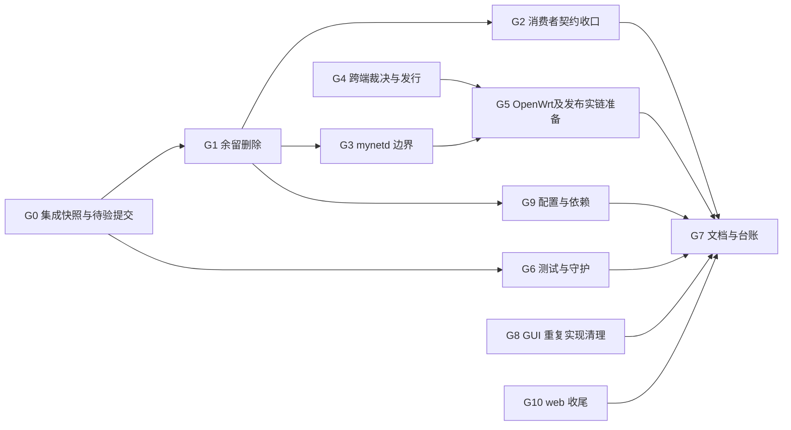

# 对账治理计划（2026-10-13，按当前代码重排）

本计划覆盖八轨对账合并后的全部发现组及本轮补充项。唯一逐项来源为 [合并台账](audit-consolidated-2026-10-13.md) §3；原 [重点总报告](audit-2026-10-13.md) 与 [8 份分册](audit-2026-10-13/) 保持冻结。已运行测试的证据留在 [接续记录](governance-followup-2026-10-13.md)。旧版 G1-a/b/c/d「执行中」、G2–G6「未开始」被本计划的逐项状态替代，不能继续据旧总状态重复开工。

## 1. 目标、范围与完成尺度

MyNet 面向普通用户创建节点与连接，以后端作为业务权威、GUI 提供用户交互、agent 执行系统能力、OpenWrt 提供薄桥、desktop 提供图形化安装、ctl 负责分发与知识库。首个验收场景是：用户登录→配置已有节点→拿到真实配置→启动/停止→读取状态；发布场景是同一版本正确取安装器或更新归档。

治理方向继续采用用户已裁定的「先删，再修，最后才增」。死假方法优先删除；有消费者的坏功能不得单边砍掉或自动补后端接口。已有等价真接口可提出迁移方案，但必须核参数、身份、返回值和授权语义。API/GUI/agent/ctl/OpenWrt/desktop 在范围；web 三项保留工作包但避开他人文件；gnb 源码与 utc 实现不在范围。不做现网变更或自动发布。

原分册共 170 个发现块（包含一个路由组、一个核查通过）；9 个重复来源合并后为 161 组，其中问题 160 组。**当前开放来源组 87 个**（67 待修、12 部分、4 未提交进行中、2 待裁决、2 待核实），另有 **69 已提交待复验、3 已验证本地、1 保留备案、1 非问题**。补充项中 **N-01/K-01/K-02 仍开放，N-02 已验证本地**。发现组包含多对象，不把这些数字当端点/类/文件数量。

本次交付是完整规划，不据规划文案销账。已提交项由 G0 确认原清单覆盖与当前测试；实机、生产、迁移结果必须单独记证据，不与本地测试混算。

## 2. 冻结边界与行为

| 面 | 必须保留的合同 | 禁止自动改变 |
|---|---|---|
| 身份/授权 | 人用登录会话；节点用既有 DH+HMAC；业务授权归后端；用户面不另造恒 true/role 门控 | 把节点私钥作为 UI 权限、在 gateway/relay 加鉴权、从 per-key 删除映射为整节点撤销 |
| 租户 | 既有 tenant-native 来源/属主判据；缺上下文 fail-closed | 恢复隐式租户1、让 X-Tenant-ID 测试超集冒充生产 |
| 节点/密钥 | nodeId/algorithm/hex布局及 BundleEnvelope schema/checksum/generation 不变；私钥下发仅走已批准信封 | 单端改命令词表、把私钥放日志/通用响应/argv、换钥或重写 gnb 私钥布局 |
| 驱动/路径 | 系统操作归 mynet 执行器，mynetd 通信；gnb route.conf 正式配置只按驱动合同处理 | 删除正式 route.conf、引入第二路由 writer、按名字杀进程 |
| 端口/命名 | localapi8096/gateway8710；产物 mynet_agent_*；源码 mynet_api/后端 | 更名现网库 mynet_back、back_priv/back_pub、已发布字段/URL |
| 发布 | filename 是下载精确身份；kind/ext/platform/arch/variant 的既有含义保留 | 仅修下载选择器却不发布归档；将 installer 当 archive 解包；默认推送或部署 |
| 数据/配置 | 不读用户私钥材料；默认不改生产库；vendor/dsplat 只读 | 删除 gitignored 凭证/备份、直接改框架副本、编辑已执行迁移历史 |

读取节点状态属于 metadata-only；配置/密钥/信封属于 inspect-body，禁止输出原始私钥；应用配置属于 transform-body，必须通过执行器合同。发布产物内容仅为本地文件校验，SHA256/版本/来源是可审计元数据；不把 token、口令、私钥放验证报告。接口安全责任保持在原拥有者，relay 只透传允许路径。

## 3. 执行次序与文件归属

- 第一批：G0 集成并重验；G6.a 处理 N-01 guard 诊断；G1 删除余留。三者先核文件重叠，同文件由一个执行者负责。
- 第二批：G2 先出消费者对应表和删/迁移裁决；G3 先冻结执行器接口再迁实现；G9 配置去重。G4 可同时准备完整裁决材料，未裁决前不改 wire/schema/发布矩阵。
- 第三批：G4 决策后两侧实施；G5 做本地合同/设备与发布验收准备；G8/G10 按归属接续；最后 G7 回写所有状态。
- 不自动派发子 agent；下列拥有者是工作包职责。若另行多人执行，可在**无重叠文件**时并行 G1-api/G1-ctl/G8；G2 与 G8 都会碰 GUI 服务/页面，G3 与进行中的 agent 生命周期修复、G6 与 guard 模板、G7 与知识库正文都不能无协调并行。
- 开工先读 git status/HEAD。`mynet_api/tests/TestCase.php`、agent 托盘/服务名/home/handlers/wizard、web guard 为他人未提交，先集成其结果或明确接手，不覆盖、不提交其未完成文件。

## 4. 工作包（开放项逐项归属见 §5）

### G0 集成已有修复、刷新状态与完整复验

**拥有者**：各仓集成负责人；负责当前基线，不继续按旧审计的“未修”重做。输入：合并台账所有「已提交待复验」「已验证本地」「进行中未提交」与每册疑点。

先对 69 个已提交组核文件/符号/路由清单覆盖，不只核 commit 标题；一组多个对象必须逐一对应。已确认修复的两条端点消费者结论（router-keys、avatar/me/url）留保留理由。接收并验证 TestCase、托盘/SCM/label/home 的进行中改动，测试与实现、调用者同批提交；裸 mynet_tray 构建产物不得进源码。project-memory 表必须与交付时 HEAD/worktree 一致，历史测试计数不复用为当前。

**必须验证**：后端镜像含全局中间件、stateful、异常渲染及租户组；GUI 新守卫过期/登录/登出/callback；agent 私钥 stdin 与 argv 各失败出口；ctl filename/kind/版本 roundtrip；OpenWrt v1 路径与剩余 Lua 操作。tests/TestCase 不能只复制生产代码后用注释字符串证明镜像仍在，生产配置与测试共用配置或用去注释守卫+行为测试锁住。

**交付**：逐行销账证据（HEAD、file:line、命令、计数、skip原因）、干净/进行中清单、未验边界；每册疑点逐条变成「成立→工作包」「否定→理由」「仍待核→阻断条件」。gnb/utc 只记录限制，不推进实现。不能因业务代码已提交标上线完成。

### G1 余留死代码、生成物与发布垃圾删除

**拥有者**：各仓代码负责人。依赖 G0 消费者复核；输出删除清单与构建/路由影响。

- API：listUsers、5 个静态异常死助手、admin 日志配置/死 tenant_isolation 开关、两个危险租户 helper、空目录。A1 的零消费者复核剩余按 G2，GatewayNotifier routeChanged/broadcast 按 G3 的通知合同核后再删，不能切断活通知。
- GUI：getDashboardData/mock 栈先复核服务/barrel/字符串/测试全消费者；确为死方法只删该方法和失去消费者的 mock 文件，不删真正 DashboardPage/useDashboard；清未用 import。`.quasar` 与 `front/.quasar` 生成物出索引并忽略，保留 `npm ci→quasar prepare→typecheck/build` 可重建；三个 public 测试 HTML 移至开发测试目录，生产产物中不得存在。
- ctl：verify-endpoints.php、buildDistUrl 若仍零消费者则删除。ReleaseService 上传/ext 与坏 URL fallback 是活功能，不能当死函数随手删，归 G4。
- OpenWrt：无人调度 heartbeat.sh 与包安装行同删，保留旧 cron 清理迁移；13 个 LuCI 端点逐个复核 controller/页面/桥/agent/脚本/guest 动态调用，确认无消费者才删并同步路由。
- agent：keyprove/genvec 先辨向量生成器真实职责；实验器仅有明确复现实验用途才留并标路径，否则删除。死 refresh 分支和 kernel frozen测试交 G6 分类。

**验证**：消费者查证含动态拼串/菜单/build tags/框架别名；模块加载/单仓构建/产物负断言；删功能的测试允许随功能删除但列明原因，其余断言不能为绿删除。生成物删除后从干净依赖/prepare 可构建。交付一个仓一组小提交，不 push。

### G2 GUI/后端剩余断链与骗人端点协同收口

**拥有者**：GUI+后端合同负责人。先提交双侧消费者表和裁决，不单端补假端点。

| 子项 | 已核现状 | 建议方案与不得越过的界限 |
|---|---|---|
| 四个鉴权 URL | api.ts 仍有 validate-reset-token/change-password/activate-account/resend-activation-email | 默认删无真能力的壳；现有 verify-email/resend-verification/PUT auth/password 只有在载荷、token类型、登录前后身份完全等价时才迁。无 reset-token 等价能力则删预校验，不自动增加接口 |
| per-key 撤销/状态 | 后端仅整节点 keys 撤销 | 删 per-key 按钮/调用或另裁真能力；严禁静默映射成全节点撤销，避免误删全部密钥 |
| route stats / history | GUI 仍调无路由；history已有 peer-connections 真能力 | 无等价统计能力则删显示/请求壳；history迁移需确认 nodeId与routeId关联、分页/时间/字段对齐，不只换 URL |
| users/onboarding | PUT仍仅日志却返回成功，GUI有消费者 | 两端删除假持久化链为首选；本地引导仍需要时明示本地状态，不伪称云端保存。恢复落库需业务新批准，不能以补实现默认推进 |
| 兼容/幽灵调用 | route/connect仍在 composable/service；legacy config-bundle尚在后端；v2 Rewrite有 ctl消费者 | 零调用connect删；旧bundle待消费者全迁后删；v2兼容层在仍用它的ctl消费者迁完前保留，并给退出条件 |

**决策输入**：每项保留/删除/迁现有真接口的具体 UI 与返回字段；用户前次“默认删”指引有效，但原计划 G2 明示裁决的部分先记录为待裁决，不能把本次“出计划”当新增实现授权。没有必要为已经删除的 check-availability 再提出实现决定。

**验证**：真实路由/HTTP身份、网络请求/响应字段、失败态页面、404消除或功能完全删除；负测试确认旧入口不可达、整节点密钥未被 per-key 行为误撤销；浏览器回归登录→节点→连接页；mock只用于错误/执行器测试替身，不作为产品数据。

### G3 mynetd 纯通信边界与 B2 守护

**拥有者**：agent 架构负责人。范围 cmd/mynetd/**、mynetd/localapi/**、mynet执行器对应状态/路由/指纹/credential能力与 guard；依赖进行中生命周期批集成。是迁移留存能力，不是重写驱动。

**G3.a 先冻结接口**：列出当前 Ops 已有 status/route/credential/fingerprint/proxy 同类操作，优先复用。缺项先定义执行器输入、JSON结构/版本/字段缺失与错误/超时/进程退出语义，再写调用端；不能让一方猜字段。system.json、身份密钥通信和现有命令白名单不变；凭证读写必须精确0600并遮蔽错误。

**G3.b 再移实现**：移 gnb_ctl/wg/ifconfig/ps 解析、主机指标、OS route 查询、隧道生命周期判据与 proxy-policy系统副作用至执行器。mynetd 经 Ops 获取状态/分派命令；把根 mynet import 所引入的119文件执行器依赖断开。通知 routeChanged/broadcast 需核发布/WS动态消费者后决定存废，不能因仅测试引用删未来 wire 而无合同收窄。

**G3.c 最后守护**：B2扫描 cmd/mynetd 与 mynetd，补根 `mynet` 包/driver/shared/config；一次性全量依赖与存量扫描，而非仅新增行。可测试的密钥原语/纯通信小包边界明确列允许项；不要把有意的本仓 B2 分叉用模板覆盖。模板与仓副本按差异同步，加入注释不误报、import确实拦截、传递依赖确实拦截的变异测试。

**验证**：`go list -deps ./cmd/mynetd` 不再进入执行器系统能力包；多个build tag/goos均检查；注入假执行器验证超时、非零退出、坏JSON、部分状态、隐私遮蔽；同功能移前移后语义一致与多实例精确生命周期测试；四平台构建/测试面编译和本机全量测试。完成前 C1-02/03/04 保持开放。

### G4 跨端裁决、发行身份与更新链

**拥有者**：ctl+desktop+agent 合同负责人。裁决材料先交付；未裁决不改 wire 或生产唯一键。

- **D4-A B4边界**：候选为保留 BundleEnvelope 驱动字段（合法驱动配置）并给业务命令词表抽翻译层，或维持现合同并备案。裁决明确业务对象与wire字段的界线；迁移时双侧命令映射/fixtures/schema版本/兼容窗口同步，不能单端改 Gnb*/Wg* 名字。
- **D4-B 发布矩阵**：推荐 installer 与 archive 都发布，Windows更新zip、darwin更新tgz、OpenWrt更新opkg；候选替代为声明mac/win只安装器升级并同步删自更新承诺。ctl唯一键/查询需支持所选矩阵；`kind` 已有列不代表双件已可上传。身份候选为 product/platform/arch/variant/version/kind/ext 的显式约束或 filename 唯一（待选），不擅自选一种落生产。
- **D4-C 更新选择**：支持Windows `.exe` 二进制名；客户端归档不含 mynet_gateway，不能要求缺件或擅把server组件装桌面。OpenWrt不得选generic Linux归档，走声明的opkg协调；平台包选择必须同时核kind/ext/platform/arch/variant，不能仅runtime.GOOS。
- **D4-D ctl活发行错误**：上传先拒未知扩展/空kind；无效filename不得成功登记并生成 `/d/{filename}` 假链；旧产品tui/client/@mynet插件清单由业务保留/退役矩阵决定，successor必须真实。不把已有filename精确下载修复重做一遍。
- **D4-E 密钥投影与运行 conf 目录收口（2026-10-13 用户点名「这才是问题」并纠正定性）**：
  **正确模型（用户裁定口径）**：`local`/`online` 是**获取 key 的两种形式**（本地自产生 / 在线下发，`cmd_refresh.go:153`），
  不是平行密钥面；`driver/gnb/conf/<id>` 是 **VPN 驱动的运行 conf 目录**（安装布局），由 `gnb -c` 指定
  （`mynet/driver/gnb_platform_unix.go:41`），可映射到 local/online 的具体目录——密钥出现在
  `security/<id>.private` 只是「投影到驱动侧」时按 gnb 布局（128hex，驱动事实不动）落的**运行副本**
  （`shared/utils/paths.go:239` 自述「投影」、`shared/domain/config_schema.go:274`「投影到驱动侧」）。
  **待治理的真问题**：①投影物与来源物双实体（`conf/online/<t>/nodes/<id>/keys/node.private` vs
  `security/<id>.private`）无「权威/投影」标注，排查必晕（2026-10-13 本次踩坑实证）；②`mynet config keys`
  的 keys_dir 不按实际获取形式报（online 节点报 local 面）且 `MYNET_HOME` 未设时按 exe 树落 prefix 幻影路径
  （`mynet/setup_v2.go:185`）。
  **目标模型（2026-10-13 用户裁定，根治方向）**：「存就存到 conf 目录下」——
  `conf/local/<nodeId>/` 与 `conf/online/<nodeId>/` 为每节点唯一存放位（密钥 + 驱动 conf）；
  gnb 用 `gnb -c`、wg 用配置文件路径**分别指到对应目录/文件**；
  **`driver/` 安装目录层拿掉**，二进制统一装 prefix 指定目录（`/opt/mynet/bin` 等）。
  随之修改 **AGENTS §1.1「gnb 配置只写进 driver/gnb/conf/<nodeId>」口径**（规则属用户，随本裁定生效）；
  **保持不动**：gnb 协议内布局（node.conf/route.conf/security/ed25519 128hex、gnb.map 只读）、
  lifecycle-contract 服务名矩阵（路径列随动）。
  **改动面（2026-10-13 实测）**：mynet_agent 95 处引用/12+ 文件（hub=`shared/utils/paths.go` 的
  GnbConfDir/GnbBinDir/GnbNodeConfDir/WireGuardNodeDir；另 subject.go 硬编码路径列表、config_schema、
  parity、upgrade/install、cmd_install_*、mynetd events/executor_lua、tray control、driver/gnb.go）；
  openwrt Lua/tests 若干、desktop INSTALL.md、ctl 文档。存量节点迁移面：service/init 里写死的 `-c` 路径、
  `GnbBinDir` 从 home 相对改 prefix 相对（181 实测 gnb 在 home 树 driver/gnb/bin）、181/182/184/188/.180
  的 conf 树搬迁 + 回滚步骤。
  **WG 侧安排（与 gnb 对称）**：`mynet/driver/wireguard.go:158,170` 的 `ConfPath=/etc/wireguard/<iface>.conf`
  改到 `conf/<form>/<nodeId>/`；装载换路径即用——通用 Linux/OpenWrt `ip link add` + `wg setconf <iface> <file>`
  （OpenWrt init 兜底现状即此路）、热更新 `wg syncconf <iface> <file>`（`wireguard.go:229` 已实现）、
  macOS wireguard-go 起口后同走 setconf/syncconf；**磁盘只存驱动原生密钥格式**（gnb=128hex、wg=base64 44），
  hex↔base64 只留在 DB/上报边界（node_keys 表 hex 是 wire 格式），不再留双形态副本。
  **执行期裁定项**：①Windows `wireguard.exe /installtunnelservice` 是复制式（服务收 conf 进自己的
  `Data\Configurations` 且 **DPAPI 加密落盘**）——**推荐 A：接受「本目录=权威、WireGuard 服务目录=安装投影」**
  （apply 幂等重装 + status 哈希对账 + 声明 GUI 改动为临时），弃 B（wireguard-go 自管：需重造
  wintun 适配器/电源/漫游/服务恢复，属「常驻重活」反模式且丢 DPAPI 静态加密）；待实测：wg.exe 的
  syncconf 支持、/installtunnelservice 拷贝语义（192.168.0.5）；②存量迁移：`/etc/wireguard/` 残留与
  .182⇄.188 `wg_exit` 现网活隧道。
  **Windows home 口径（2026-10-14 用户裁定）**：密钥/配置放 **`C:\ProgramData\MyNet`**（机器级数据标准位，
  SYSTEM 服务可读写、不被 OneDrive/文档备份同步卷走）；程序进 `C:\Program Files\MyNet\bin`。
  **不放 Documents**（语义不对 + 私钥会被 OneDrive 同步上云）。
  **install 认领自动化（2026-10-14 实测短板）**：home 已有 mode.json+密钥（重装/认领场景）时，
  install 应自动 `setup --online --tenant <mode.json>` 收编或至少给出填好参数的可粘贴命令；
  现在只给 `<ID>` 占位提示，人工易漏跑 setup → system.json 缺失 → mynetd 不发心跳 → bundle 不下发。
  **Windows 治理缺口（2026-10-14 183 全清实测四条）**：
  ① **卸载不清理机器/用户环境变量**：旧装机 setx 的 `HKLM/HKCU\...\Environment\MYNET_{HOME,BIN,GNB_BIN,GATEWAYS}`
  是全部路径鬼打墙的总根（resolveGNBBinary 第一优先 MYNET_GNB_BIN 显式覆盖）；且 services.exe 环境缓存
  开机固化，注册表清了不重启也不生效——install 应写**服务级 Environment 覆盖值**（SCM 服务键下
  REG_MULTI_SZ），uninstall 应清 HKLM/HKCU 残留；
  ② **Windows OS 路由落地链坏**：apply 的 netsh `interface=` 解析全失败（表空/幽灵 IF 段），`replace→add`
  遇已存在即 exit 1；resolveDevice 靠「接口上的 VPN IP」找设备而 IP 配置步骤又缺——鸡生蛋；
  ③ **隧道地址无人配**：Windows 侧 apply 不给 wintun 口配 VPN IP（10.182.236.183 需手工 netsh）；
  ④ **wintun 口生命周期不稳 + 名称漂移**：adapter 名是 `P2PNet`（描述 GNB Tunnel）而 node.conf 投影无
  ifname 行——按 gnb_tun 找口必空；且口会自行消失（daemon/会话权限相关）。
  **节点迁移实测缺口（2026-10-14，181/182/180/188 收口时发现）**：
  ⑤ **密钥轮换流程断**：`config keys sync` 401（credential 指纹绑定旧钥）+ 对端 ed25519 环**投影不覆盖
  已存在公钥**（SSOT「换新钥对端解不开」的坑）→ 设计路径上无法完成轮换；188 重建密钥只能
  后端直改 node_keys + 手工换对端环。需补：轮换命令（sync 免指纹旧钥）+ 环版本化下发；
  ⑥ **tun 名被占时 gnb 无 tun 空跑不报错**：新旧双实例并存时后者静默无 tun（180/183 实测），
  进程活着、一切看似正常但零流量——应 fail loud 或抢名重试；
  ⑦ **install 不重写已存在的陈旧服务单元**（188 的 mynet_gnb.service 指旧 bin+旧布局 crash-loop 50 次）。
  附带小修：state/last-good 快照自清（只留最近 3 份，2026-10-13 已落）。

**迁移/回滚**：只生成本地迁移/DDL与重复件预检，不实施生产；明确旧rows kind回填来源、唯一键冲突、未知ext、latest维度、降级回滚可保留双kind数据的方式。迁移前备份/验证清单，冲突停止；已有生产数据不得自动去重删除。文件SHA、版本与来源固定；旧下载URL保持filename精确身份。

**验证**：同tuple两kind上传→manifest→精确下载→checksum；Windows zip含exe、darwin tgz、OpenWrt generic拒绝；variant/软浮点/未知ext/缺archive/同版本幂等/回滚；发布CI assets实际包含双方矩阵，不能只验证生成文件。

### G5 OpenWrt 留存能力与生产发布准备

**拥有者**：OpenWrt桥/agent合同负责人、ctl发布负责人。依赖G3执行器边界与G4决定；G0已修路径复验可先做。

- Lua v1映射后验证签名canonical path、DH/HMAC、压缩body、node identity、bundle与command/result所需字段。CPI-71/R1覆盖不足逐操作改薄桥/Go委托；不以v1 URL替换宣布链路完成。
- O1只退役旧注入入口已完成；Lua仍有配置/路由生成，逐项迁桥→Go apply唯一写面。历史marker读取过滤是旧配置安全处理，待“存量扫描→单次迁移→无marker验收”后再决定撤除，不能删除后把旧公网段变系统路由。
- LuCI服务操作、init单源、UCI幂等、桥缺失/超时回退必须按现行合同；不得用Lua回退恢复被禁止的第二writer。平台UCI能力留平台，跨平台路由/驱动能力归Go。
- ctl deploy.sh已有覆盖警示但仍rsync --delete；交付3月→10月真实发布diff、目标独有文件/手改清单、明确批准范围、备份、manifest与路由/schema依赖、失败停止、回滚步骤。警示不是漂移检测或上线验收。

**验证**：本地桥/ACL/方法表/JSON/失败合同与Lua5.1执行；SDK/ipk包内单源/升级保留身份/cron迁移；实际设备主机指标、心跳/配置/回执、路由唯一writer、幂等与撤销。生产/设备动作仍归用户窗口；本计划仅准备可审阅结果，不运行部署或重启。

### G6 测试质量、fixture与守护闭环

**拥有者**：各仓测试/guard负责人；不得通过skip或改坏期望值做绿。

- **G6.a N-01**：修模板/各仓 C4 输出中 `$c4_hit` 与中文括号的词法问题（使用明确变量边界）；原样自测要求退出码与原因双断言，模板/ctl目前37/8，不能记录45/0。逐仓差异同步，web他人guard等其批集成；不得改窄断言绕过失败。
- **G6.b mirror**：与G0集成TestCase；redirectGuestsTo/异常镜像守卫去注释后再检查，或生产/测试单源配置配行为测试；失败/production-only500/401/422各出口真跑。不得只grep注释作完成证据。
- **G6.c fixtures**：API NodeFace/Edwards与Go driver/keys向量改仓内版本化fixture优先、缺失硬失败；跨语言两仓同源SHA/生成方法与golden行为对照，不要求邻仓checkout才不skip。保留已明确的SQLite行锁/平台不适用skip，并在汇总列原因/替代测试。
- **G6.d test/tool区分**：ProxyExitContractDumpTest补五态golden与错误/缺授权断言或移独立dump工具；不得移走其仅有的有效权限断言。Business/Unit套件纯重复可删或标人工分组，保持Default全集；删assertTrue(true)/CACHE_DRIVER冗余；kernel_test.go.txt要恢复独立内核gate或明确维持外部验收，不能删文件冒充通过。

**验证**：删除fixture→红、注释掉生产配置→红、错误返回500→红、CLI缺二进制→红、C4不拦/理由错→红；正常主链全绿。单仓克隆能运行所声明单测；真正内核/设备缺条件时输出待验而非PASS。计数变化附被删能力/新增场景理由。

### G7 文档、API规范与台账收口

**拥有者**：知识库负责人+各仓文档负责人。依赖对应代码/裁决完成；不先把未来规划写成现状。

- 收完B2未尽修订叙事、project-memory入口、AGENTS/README/Playbook实际守护覆盖与计数；保持每份文档一处现状、历史进入冻结记录。用户裁定废D-4、operator回装、库名不更名不能漂回去。
- 后端operator/部署工具/MonitorModuleSQL依据、controller注释/模块幽灵、API OpenAPI与GUI两份openapi/旧01–06文档确定权威/归档；从真实路由与消费者导出删除/保留映射，不能给已下架端点补文档假复活。
- agent gateway独立构建/Redis presence活调用、gnb单元真实路径、README make dist/openwrt/tag、8097旧注释；desktop SCM与不带-V2；OpenWrt退役init/route、旧报告归档；ctl Laravel默认README、错位微信小程序需求/旧hotfix/todo、旧导入源与GH_BASE先核历史用途再处置。
- CPI/R表每项以当前代码和测试销账；CPI-47“两表零消费者不迁”的裁定保留，不为了对齐旧17表强迁。疑点仅按查证结果迁表，不扩散成确定bug。

**交付/验证**：链接/路径存在、接口route:list双向对账、当前入口导航、每个来源ID仍可回溯；旧报告不改取证内容；未测数字不冒充实测。此文件与合并台账是当前完整计划，接续记录只保存已完成批的详细证据。

### G8 GUI 格式化/i18n/日志重复实现

**拥有者**：GUI维护负责人。依赖G1/G2清理死页面后再精简；不碰认证守卫已修逻辑。

formatBytes/date/time/speed复用既有utils，保持单位、小数、空值/负值/时区展示；按表列各消费者迁，不一刀替换格式导致UI变义。i18n清理需覆盖模板t、动态拼键、服务端字典、菜单配置，不拿“未静态命中”当死键；将**用到的**中英对齐检查稳定接入，死键清单分开交付。console换现有debug封装，保留实际错误追踪并去敏感片段；不只靠terser作为开发日志隐私保护。

**验证**：格式化边界用例、动态键正例/漏译负例、所有页面locale切换、lint/i18n/vitest/类型逐文件棘轮只降不升、SPA与embed构建。类型债184不是零错误，本包不宣称全类型清零。

### G9 配置、框架依赖与保留项

**拥有者**：API配置/框架接口负责人。生产/env凭证只走crt，规划/测试使用非凭证夹具。

tenancy副本仅保留有意覆盖并解释fail-closed，框架默认由merge补齐；`.env.example`补真实活键/文件化back_face指引，死键同实现删；ConsoleDevSeeder走config或明确config:cache限制。Faker/factories/autoload删除先确认Testbench/框架消费者与锁文件变化，不直接删composer.lock。services.slack、vendor修改一致性、device_fingerprint长度、back_face env兼容退役时点、dev-main版本别名属于核验/裁决，未核不得改上游或轮换线上密钥。

K-01先区分Reverb公开app key与服务端secret，客户端fallback副本可收口到配置；不把公开app key误报为秘密，不据CPI-7自动轮换。A2-21的已发布迁移同时间戳保留备案、新迁移唯一；本地console旧chunk清理只在构建来源和索引已知时做，不删除用户未知资产。

**验证**：config:cache后活键/Seeder行为、缺env/非法配置明确错误；生产缺租户仍fail-closed；composer validate/干净依赖安装；框架缺陷有上游报告，vendor原样只读。DDL/schema变更需独立测试与迁移方案。

### G10 web 定位与剩余三个审计项

**拥有者**：web维护负责人。只处理C3-25/26/27，先等 `.githooks/guard.sh` 他人工作集成，不替换其文件。

按已裁定官网定位，删除/摘除四个社区域空壳路由；本机页属于历史素材的处置先列消费者，README不再写双域WebUI，Settings旧v2占位符与check.sh CPI-40误指改正确当前口径。与CPI-45无真构建管线的既有缺口分别记账，删壳不代表补了构建能力。

**验证**：路由负断言/官网导航、README与结构一致、check输出编号；若本仓构建缺依赖或无真pipeline，保留明确未验，不把文件存在检查当功能验收。本包不合并GUI/web，不恢复已作废D-4。

## 5. 逐项来源覆盖索引

以下由合并台账逐行映射。每个发现组有一个主工作包；所有已提交组另由G0复验，重复来源ID只在合并台账出现，不重复排期。N/K项与分册发现分开计数。该索引是完整覆盖关系，不是建议选做名单。

| 工作包 | 全部来源组 / 当前状态 |
|---|---|
| G0 | A1-01（已提交待复验）；A1-07（已提交待复验）；A1-08（已提交待复验）；A1-09（已提交待复验）；A1-10（已提交待复验）；A1-11（已提交待复验）；A1-13（已提交待复验）；A2-01（已提交待复验）；A2-02（已提交待复验）；A2-03（已提交待复验）；A2-04（已提交待复验）；A2-06（已提交待复验）；A2-07（已提交待复验）；A2-09（已提交待复验）；A2-10（已提交待复验）；A2-11（已提交待复验）；A2-14（已提交待复验）；A2-22（待核实）；A3-01（进行中未提交）；A3-02（进行中未提交）；A3-03（已提交待复验）；A3-04（已提交待复验）；A3-05（已验证本地）；B1-03（已提交待复验）；B1-07（已提交待复验）；B1-08（已提交待复验）；B1-09（已提交待复验）；B2-02（待修复）；B2-03（已提交待复验）；B2-04（已提交待复验）；B2-05（已提交待复验）；B2-06（已提交待复验）；B2-07（已提交待复验）；B2-08（已提交待复验）；B2-09（已提交待复验）；B2-10（已提交待复验）；B2-11（已提交待复验）；B2-12（已提交待复验）；B2-14（已提交待复验）；B2-15（已提交待复验）；B2-16（已提交待复验）；B2-17（已提交待复验）；B2-18（已提交待复验）；C1-18（已提交待复验）；B2-21（已提交待复验）；B2-22（已提交待复验）；B2-23（已提交待复验）；B2-24（已提交待复验）；B2-26（已提交待复验）；C1-01（已提交待复验）；C1-05（已提交待复验）；C1-06（进行中未提交）；C1-07（已提交待复验）；C1-09（已提交待复验）；C1-11（进行中未提交）；C1-12（已提交待复验）；C1-20（非问题保留）；C2-01（已验证本地）；C2-02（已提交待复验）；C2-03（已提交待复验）；C2-04（已验证本地）；C2-05（已提交待复验）；C2-06（已提交待复验）；C2-07（已提交待复验）；C2-09（已提交待复验）；C2-10（已提交待复验）；C2-11（已提交待复验）；C2-12（已提交待复验）；C2-13（已提交待复验）；C2-14（已提交待复验）；C2-18（已提交待复验）；C3-01（已提交待复验）；C3-02（已提交待复验）；C3-04（已提交待复验）；C3-05（已提交待复验）；C3-09（已提交待复验）；C3-10（已提交待复验）；C3-12（已提交待复验）；C3-16（部分修复）；C3-19（已提交待复验）；N-02（已验证本地） |
| G1 | A1-12（待修复）；A2-05（待修复）；A2-08（待修复）；A2-12（待修复）；A2-13（待修复）；A2-15（待修复）；A2-17（待修复）；B1-10（待修复）；C1-14（部分修复）；C1-21（待修复）；C2-08（待修复）；C2-15（待修复）；C2-16（待修复）；C2-21（待修复）；C3-06（待修复）；C3-07（待修复）；C3-18（待修复）；C3-20（待修复） |
| G2 | A1-03（部分修复）；A1-04（待修复）；A1-05（待修复）；A1-06（待修复）；A1-14（部分修复）；A1-15（待修复）；B1-01（待修复）；A1-Z01（部分修复） |
| G3 | A2-16（待修复）；C1-02（待修复）；C1-03（待修复）；C1-04（待修复） |
| G4 | A1-02（待裁决）；B1-02（待裁决）；C1-10（待修复）；C3-03（待修复）；C3-08（待修复） |
| G5 | C3-11（部分修复）；K-02（待修复） |
| G6 | A3-06（待修复）；A3-07（待修复）；A3-09（待修复）；A3-13（待修复）；A3-14（部分修复）；A3-15（待修复）；B2-01（部分修复）；C1-15（待修复）；C1-22（待修复）；C1-23（待修复）；N-01（待修复） |
| G7 | A1-16（待修复）；A1-17（待修复）；A3-10（待修复）；A3-11（部分修复）；A3-12（待修复）；B1-12（待修复）；B2-25（部分修复）；C1-08（待修复）；C1-16（部分修复）；C1-17（部分修复）；C1-19（待修复）；C2-22（待修复）；C2-23（待修复）；C2-24（待修复）；C2-25（待修复）；C2-26（待修复）；C2-27（待修复）；C3-13（待修复）；C3-14（待修复）；C3-15（待修复）；C3-21（待修复）；C3-22（待修复）；C3-23（待修复）；C3-24（待修复） |
| G8 | C2-17（待修复）；C2-19（待修复）；C2-20（待修复） |
| G9 | A2-18（待核实）；A2-19（待修复）；A2-20（待修复）；A2-21（保留备案）；A3-08（待修复）；K-01（待核实） |
| G10 | C3-25（待修复）；C3-26（待修复）；C3-27（待修复） |

## 6. 验收、回滚与提交纪律

| 仓/面 | 必须出口 | 不能替代出口的证据 |
|---|---|---|
| API | make test；改动Pint/guard；涉及DDL跑真对应引擎测试；CLI/NodeFace真实链 | 仅fixture长度、缺依赖skip、SQLite替MariaDB行锁/方言 |
| agent | go build ./...、go test ./...、make guard；涉及边界加go list；四平台tag构建/测试面编译 | 交叉编译当Windows实机、grep注释当安全行为 |
| GUI | make check（eslint/i18n/类型棘轮/vitest）、SPA/embed构建、相关浏览器流程 | 摇树成功当死消费者证明、类型基线允许增长 |
| ctl | make test、make guard；上传→manifest→下载→kind/checksum往返 | 表里有kind当双件发布可用、schema预检当迁移已上线 |
| OpenWrt | Makefile.guard check、Lua5.1、桥ACL/方法表、SDK/ipk必要验收 | Lua5.4解析当5.1设备验收、路径替换当HMAC链已通 |
| desktop/web | 各仓现有check与相关构建、安装/路由流程实机或明确待验 | 安装器脚本字串当注册/启停正确、空文件存在当页面能力 |
| 文档 | 源ID全覆盖、来源文本完整、链接存在、状态/依赖/阻断一致 | commit标题当整组闭环、旧测试数字当当前绿 |

系统迁移先备份清单、验证归属、失败停止，再删除旧入口；数据库/发布矩阵在裁决后出重复件预检及可逆DDL，不自动部署。用户资产不做删除；回滚要明确恢复哪个注册标识/文件/规则，不按进程名字杀。安全入口保持fail-closed，timeout/坏JSON/未知ext/缺配置不得返回假成功。

每仓小提交、精确git add、不提交构建产物、不push；提交依赖（如未提交TestCase镜像）必须显式列出。交付填写：工作包/来源ID、文件、新增接口（如有）、行为与迁移/隐私影响、测试命令结果/计数/skip原因、局限、后续依赖。回写合并台账与接续证据；只有全部相关子项有证据才从部分修复转已验证，生产/设备待验单列。

## 7. 计划交付状态

本轮仅完成八轨全文合订、逐项去重/状态映射、治理工作包和覆盖验证；不表示G0～G10实施完成。需要用户裁决的具体事项是G2有消费者功能的处置以及G4 wire/双kind发布矩阵。其他开放包可按次序准备与实施，但须遵守本次任务范围：本轮不自动继续改业务代码。
