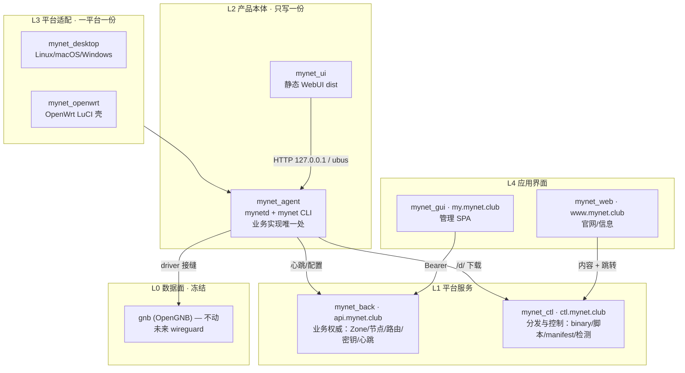

# MyNet 全生态整合规划 v2

> **版本**：v2.0 · 2026-09-21
> **取代**：`integration-plan.md` v1.0（2026-03-20，旧线口径；保留作 ADR/历史参考，见文首横幅）
> **适用范围**：**目标线 + 服务层**（本文件全面适用）；旧线仅冻结归档（§2）
> **目标读者**：各子项目开发者、架构决策者
> **SSOT 落点**：本文件 + 同目录 `spec/`、`../api/`、`conventions.md`

---

## 0. 摘要

v1 规划（2026-03）描绘的是「Node.js client 作为下一代统一客户端」的旧形态。
此后架构已演化为**产品本体与平台适配分离**的四仓线：

```
mynet_agent + mynet_ui        ← 产品本体（跨平台，只写一份）
mynet_desktop / mynet_openwrt ← 平台适配（一平台一份）
```

v2 的任务是把规划**重新锚定到这个分层**，并把四件本轮选定的事做实：

| 工作流 | 一句话 | 产物 |
|--------|--------|------|
| **W1 文档对齐** | 把 spec/api/conventions 从旧线口径改到新线口径 | `spec/README.md`、`../api/version.json`、`../api/references/client-matrix.md`、`conventions.md` |
| **W2 driver 抽象** | 把 gnb 特有物收敛到驱动边界，为替换 wireguard 留接缝 | `spec/driver-abstraction.md` |
| **W3 API 对齐** | 以 OpenAPI/矩阵为基准，列出并归位 back/ctl↔客户端的实际偏差 | `../api/references/alignment-backlog.md` |
| **W4 back 业务上移** | 定义 back 为业务权威、客户端变薄的状态归属 | `back-upshift-design.md` |

> **本规划的一条主线**：`gnb` 冻结不动（§6 不变量 I1），其余全部向 back 收敛业务、向 driver 收敛差异、向 SSOT 收敛事实。

---

## 1. 分层目标态

### 1.1 五层模型



### 1.2 四仓角色（目标线的核心认知）

| 仓 | 是什么 | 不做什么 | 现状偏差 |
|----|--------|----------|----------|
| **mynet_agent** | 产品本体：`mynetd` 常驻 + `mynet` CLI + 本机 HTTP/ubus 能力面 | 不碰平台打包、不提供全屏 UI | 业务已成型，driver 接缝已有接口（`internal/domain/vpn_driver.go`） |
| **mynet_ui** | 本机静态 WebUI（`dist/`） | 不含 Node/Express 服务端、不直连云端 | 只有页面，能力全靠 agent |
| **mynet_desktop** | 非 OpenWrt 平台胶水：install/service/pack/logrotate | 不含业务逻辑 | **过渡态**：`install.sh` 仍装旧 Node client，需去 Node 化 |
| **mynet_openwrt** | OpenWrt LuCI 壳：菜单/模板/ipk/rpcd ACL/ubus 权限 | 目标态不含完整业务 | **过渡态**：`luasrc/model/mynet/*.lua` 仍有完整业务（`node.lua` ~1450 行），是迁移源 |

> **判据**：业务代码改了只进 `mynet_agent`；打包/服务单元/防火墙脚本改对应平台仓；页面改 `mynet_ui`（桌面）或 `mynet_openwrt`（路由器壳）。

### 1.3 双通道能力面（agent 的既定契约）

`mynet_agent/docs/API.md` 已定义：**同一能力面，两种传输**。

| 平台 | 传输 | 鉴权 |
|------|------|------|
| 桌面/Linux/Windows | `HTTP 127.0.0.1:<port>/api/v1` | 本机 local token（0600 文件） |
| OpenWrt | `ubus mynet.*` | LuCI 会话 + rpcd ACL |

**实现只有一份 = mynetd。** 壳（ui / LuCI）只调不改。

---

## 2. 范围与冻结策略

### 2.1 纳入整合（目标线 + 服务层）

`mynet_agent` · `mynet_ui` · `mynet_desktop` · `mynet_openwrt` · `mynet_back` · `mynet_ctl` · `mynet_gui` · `mynet_web`

### 2.2 冻结归档（保留但不再投入改造）

| 仓 | 冻结原因 | 后续 |
|----|----------|------|
| `mynet_client` (Node) | 产品线退役，职责已拆分到 agent/ui/desktop | 归档；文档标注「已由 agent 线取代」 |
| `mynet_tui` (Go) | agent 自其抽出，TUI 产品线谢幕 | 归档 |
| `mynet_lua` | 业务迁往 `mynet_openwrt` + mynetd | 保留作 `mynet_openwrt` 的迁移源 |
| `mynet_client-hotproxy` | client 的代理分支 | 归档；相关能力并入 agent 的 proxy 域 |

### 2.3 明确不做

- 不改 `mynet_gnb` 源码（§6 I1）
- 不新建跨仓 SSOT 仓（继续用 `mynet_ctl/docs`，见 §5）
- 不恢复 TUI / 不复活 Node client

---

## 3. 四条工作流（本轮选定）

### W1 · 文档对齐新线

**目标**：SSOT 的「适用项目」与「产品/客户端清单」不再指向旧线，避免按文档开发却做出旧形态。

| 任务 | 文件 | 动作 | 验收 |
|------|------|------|------|
| W1-1 | `spec/README.md` | 适用范围 `mynet_lua/mynet_client` → **mynetd（唯一实现）+ ui/desktop/openwrt（壳）**，加实现归属映射表 | 打开 spec 能明确「谁实现」 |
| W1-2 | `../api/version.json` | `clients` 增补 `mynet_agent`/`mynet_ui`/`mynet_desktop`/`mynet_openwrt`，旧线标记 `status: frozen` | 客户端矩阵与 version.json 一致 |
| W1-3 | `../api/references/client-matrix.md` | 增列 agent/ui（HTTP/ubus 双通道），旧 lua/client 列降为 frozen | 新客户端有独立列 |
| W1-4 | `conventions.md` | 产品表更新：`client` 说明拆分为 agent 线；`lua` 标 frozen；补 `agent` 条目 | 命名 SSOT 与实际分发物一致 |

**依赖**：无。**可与 W2/W3/W4 并行。**

### W2 · driver 抽象与 wireguard 预留

**目标**：把 gnb 特有物收敛到驱动边界，使未来替换为 wireguard 的成本 = 「写一个 driver + 注册」，而不是满仓改。

泄漏点（当前硬绑 gnb 的四处）：

| # | 泄漏点 | 位置 | 收敛动作 |
|---|--------|------|----------|
| L1 | 配置包生成 gnb 原生格式 | `back` config-bundle（`node.conf`/`address.conf`/`route.conf`） | 抽象为 **driver-agnostic bundle**，driver 侧做适配 |
| L2 | 热重启机制 | `agent` `gnb_ctl -w core.flag=2` + `gnb.map` | 收进 `VPNDriver.Reload()` |
| L3 | 分发产品名 | `ctl` manifest 的 `gnb` 条目 | 产品表补 `wireguard`，命名走 `conventions.md` |
| L4 | 文档/spec 格式定义 | `spec/data-models.md` §4/§9 | 拆分为「抽象层」+「gnb adapter」两节 |

**产物**：`spec/driver-abstraction.md`（抽象 bundle schema + driver 接口 + WG 映射表 + 落地步骤）。

**依赖**：无（设计先行）；实现阶段依赖 W3 的 back 契约稳定。

### W3 · API 对齐修偏差

**目标**：把「文档说的一套、客户端调的另一套」压平。基准 = `../api/openapi/*.yaml` + `client-matrix.md`；偏差源 = `references/issues.md` + `AUDIT_2026-04-24/`。

| 类别 | 来源 | 处理 |
|------|------|------|
| BUG（B1-B3） | issues.md | 按新线重新归属：B1 归 openwrt，B2/B3 归 back |
| 字段不匹配（M1-M5） | issues.md | 旧 client/lua → 重新指向 agent/openwrt |
| BLOCKER（N1-N3） | issues.md | back 补端点 |
| DOC GAP（43 个） | audit | 增量补 `back.yaml` |
| 新增：agent/ui 面 | 本规划 | 矩阵缺 agent/ui 行 → 补 |

**产物**：`../api/references/alignment-backlog.md`（带 owner/优先级/状态的单一清单）。

**依赖**：与 W1 互为输入（矩阵要先有 agent 列）。

### W4 · back 业务上移设计

**目标**：明确「业务逻辑向上长」的边界——back 承载业务权威与策略，客户端变薄为执行器。

**产物**：`back-upshift-design.md`（状态归属矩阵 + 上移/下沉判据 + 与 W2 的接口 + 反模式 + 落地清单）。

**依赖**：与 W2 强相关（back 产出的 bundle 必须 driver-agnostic）。

---

## 4. 阶段路线

| 阶段 | 主题 | 内容 | 出口判据 |
|------|------|------|----------|
| **P0**（本轮） | 事实对齐 | W1 文档对齐 + W2/W3/W4 设计定稿 | 五份 SSOT 文档落库且互链一致；无代码改动 |
| **P1** | 契约固化 | 按 W3 清单修 back/ctl 偏差；按 W2 落 driver 接口壳（仅接口，不接 wg） | 偏差清单 P0 项清零；driver 接口编译通过 |
| **P2** | 壳瘦身 | openwrt Lua 业务 → ubus 转发；desktop 去 Node 化 | LuCI 壳无独立业务；desktop 装 agent 二进制 |
| **P3** | 业务上移 | 按 W4 把策略计算迁入 back；客户端只做执行与上报 | 客户端无重复策略实现 |

> 本规划只对 P0 承诺交付；P1-P3 为方向锚点，逐轮细化。

---

## 5. SSOT 归属表（防漂移）

**一条事实只写一处**，其余引用。

| 事实 | 唯一归属 | 消费方 |
|------|----------|--------|
| 生态全景 / 分层 | `knowledge-base/ecosystem.md`（本 v2 §1 为其新线修订） | 全部 |
| 整合规划与任务 | **本文件**（integration-plan-v2.md） | 全部 |
| 命名/平台/架构矩阵 | `conventions.md` | ctl 分发、打包脚本 |
| API 版本与 OpenAPI | `../api/version.json`、`../api/openapi/*.yaml` | back/ctl/全部客户端 |
| 客户端字段匹配 | `../api/references/client-matrix.md` | 全部客户端 |
| API 偏差待办 | `../api/references/alignment-backlog.md` | back/ctl/客户端 |
| 操作契约（跨端一致逻辑） | `spec/*.md` | mynetd 实现 + 各壳 |
| driver 抽象契约 | `spec/driver-abstraction.md` | agent、back |
| 数据格式（JSON/conf） | `spec/data-models.md` | 全部 |
| 业务权威边界 | `back-upshift-design.md` | back、客户端 |
| 部署清单 | `deployment-registry.md` | 运维 |

---

## 6. 不变量与风险

### 不变量

- **I1 · gnb 冻结**：不改 `mynet_gnb` 源码。所有 gnb 相关差异收敛到 driver 边界（W2）。
- **I2 · 契约先行**：涉及跨端一致逻辑的改动，先改 `spec/` 再改实现（沿用 `spec/README.md` 工作流）。
- **I3 · 向后兼容**：back 的既有端点不静默破坏；v1/v2 并存策略沿用 v1 规划 §15。
- **I4 · 业务单一实现**：同一业务逻辑不在多仓重复实现（壳只转发）。

### 风险

| 风险 | 影响 | 对策 |
|------|------|------|
| 文档与代码再次漂移 | 规划失效 | §5 归属表 + 契约变更加 `[spec]` 提交标签 |
| openwrt 壳瘦身回归 | 路由器功能受损 | P2 分步迁移，逐域替换，保留回滚 |
| 「业务上移」被理解为「客户端无脑转发」 | 离线/断网场景退化 | W4 明确离线降级边界 |
| driver 抽象过度设计 | 成本 > 收益 | 只抽**已泄漏的四处**，不做通用插件框架 |

---

## 7. 交付物索引（P0）

```
mynet_ctl/docs/
├── knowledge-base/
│   ├── integration-plan-v2.md      ← 本文件（规划主文档）
│   ├── integration-plan.md         ← v1，已加「被取代」横幅
│   ├── back-upshift-design.md      ← W4
│   ├── ecosystem.md                ← 按 §1 分层修订
│   └── spec/
│       ├── README.md               ← W1-1 适用范围改新线
│       └── driver-abstraction.md   ← W2
├── api/
│   ├── version.json                ← W1-2 补 agent/ui/desktop/openwrt
│   └── references/
│       ├── client-matrix.md        ← W1-3 补 agent/ui 列
│       └── alignment-backlog.md    ← W3
└── conventions.md                  ← W1-4 产品表更新
```

---

## 附：与 v1 的关键差异

| 维度 | v1（2026-03） | v2（本文件） |
|------|---------------|--------------|
| 客户端形态 | Node client = 下一代统一客户端 | agent+ui = 本体，desktop/openwrt = 平台 |
| 分层 | 应用/平台/基础设施 三层 | 界面/适配/本体/服务/数据面 五层 |
| gnb 定位 | 底层二进制，可自动化发布 | **冻结**，仅保留 driver 接缝 |
| 规划重心 | 各项目任务清单（B-/C-/D-/G-） | 四条工作流（对齐/抽象/契约/上移） |
| 业务逻辑归属 | 客户端各自实现 | 向 back 上移，客户端变薄 |
