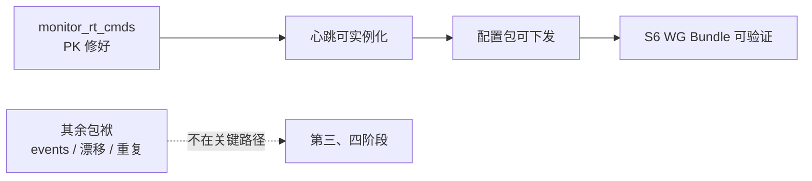

# SPEC: mynet_back 历史包袱清理

> 更新：2026-09-21 | 适用：`mynet_back`
> 状态：**第一、二、三阶段已完成**；第四阶段（化妆性清理）待做
> 依据：本文件全部结论均来自实测（`ClassLoader::findFile` / `information_schema` / PHP fatal），非推断

---

## 0. 执行进度总览

| 阶段 | 状态 | 关键结果 | 提交 |
|---|---|---|---|
| 一 · 打通关键路径 | ✅ | `MonitorRtCmd` 可加载；心跳链 6 个类可实例化；外键违规 0 | `1a550529` |
| 二 · 消除不可解析引用 | ✅ | **31 → 4**；新建 `RolePermission`/`SocialConnectionId`；修 13 处漂移；删 3 个死文件 | `1c87dc9a` |
| 三 · events 系统 | ✅ | **17 个 handler 全部静默失效 → 11 个可解析且可实例化**；删 2 个无实现的 event 定义 | `3674b1a9` |
| 四 · 化妆性清理 | ✅ 3/4 | 删 19 个死 import；发现器改名 `ModuleDiscoveryServiceProvider`；遗留 dump 归档至 `docs/legacy/` | `c79f1ac8` |
| — `tests/Schema` 重构 | ⬜ | 24 个模块描述的是**第三套 schema**，与 dump 和真实库都不符；改为从真实库导出 | 另立任务 |

**当前不可解析引用仅 4 个**，全部是刻意保留的 Notification 地雷（见 §2.3）。

### 已完成的两项"别建表，该删代码"

`Monitor` 的 `alert_histories`/`service_metrics` 与 `customers` 表并不存在，但**不是缺口**：
指向它们的 8 个文件构成一个**无活消费者的封闭死簇**（0 外部引用、无调度/路由/绑定）。
建表等于给一个没有消费者的功能造需求 → 删除（`c0ac992d`）。


---

## 0. 排序原则

**不按「严重度」排，按「是否在 WG 关键路径上」排。**

原因：`MonitorRtCmd` 加载即 fatal，而它被 `NodeHeartbeatController` / `NodeActionController` /
`MonitorCommandService` 引用 —— 而**节点配置分发正是走心跳命令链**（back → heartbeat →
`node.refresh` / `route.refresh`）。所以它不是"清理"，是 WG 的**前置**。

### 第一阶段执行结果 ✅

| 项 | 结果 |
|---|---|
| `MonitorRtCmd` 类加载 | ✅ 可加载，PK=`rt_cmd_id`，keyType=int |
| `HasGlobalId` 生成 | ✅ 实测 `rt_cmd_id=5466397989490496`（16 位） |
| 关键路径类实例化 | ✅ `NodeHeartbeatController`/`NodeActionController`/`NodeConfigService`/`NodeRebootService`/`MonitorCommandService`/`NodeOperatorDomainService` |
| `monitor_rt_cmds` 主键 | ✅ `rt_cmd_id bigint unsigned`（UUID `id` 列已删） |
| 外键违规 | ✅ 全库 104 个外键 **0 违规**（修复了先前清理遗漏造成的 503+6 行悬空） |
| `route:list` | ✅ 仍 1090 |
| 残留 `App\Models\MonitorRtCmd` | ✅ 0（6 处内联 FQCN 已改） |

**待决**：`notifications` 表（app 迁移 `2026_06_25_000002` 用 Laravel 默认 `$table->uuid('id')`）
仍是 `char(36)`；而 `in_app_notifications` 已用 `in_app_notification_id bigint unsigned` + `HasGlobalId` ✅。
改 `notifications` 需覆盖 Laravel 的 `DatabaseNotification`（它 `$keyType='string'` 且生成 UUID）——
属独立决策。




---

## 1. 实测清单

### 1.1 坏在加载期

**`App\Modules\Monitor\Models\MonitorRtCmd` —— 加载即 fatal（两处坏）**

```
Trait method Illuminate\Database\Eloquent\Concerns\HasUuids::getKeyType has not been
applied as App\Modules\Monitor\Models\MonitorRtCmd::getKeyType, because of collision
with MultiTenantSaas\Concerns\HasGlobalId::getKeyType
```

`use HasFactory, HasGlobalId, HasUuids;` —— 两个 trait 都定义 `getKeyType()`。

且模型声明 `$primaryKey = 'rt_cmd_id'`，而实测表结构**没有这一列**：

```
monitor_rt_cmds: id, node_id, command, params, status, priority, result,
                 error_message, created_at, updated_at, executed_at, expires_at
PK = id
```

→ 需**迁移补 `rt_cmd_id` 列** + 模型改 PK + 去 `HasUuids`。只改 trait 不够。

### 1.2 指向不存在的表（Monitor 半建状态）

| 模型 | 声称的表 | 实测 |
|---|---|---|
| `App\Models\Customer` | `customers` | ❌ 不存在 |
| `Monitor\Models\ServiceMetric` | `service_metrics` | ❌ 不存在（`service_metrics`/`monitor_alerts`/`node_metrics` 皆无） |
| `Monitor\Models\AlertHistory` | `alert_histories` | ❌ 不存在（`alert_history` 也无） |

存在的 Monitor 表只有：`monitor_rt_cmds`、`node_monitor_snapshots`、`node_peer_connections`。

### 1.3 死代码（0 引用，实测）

| 类 | 引用数 |
|---|---|
| `App\Modules\Monitor\Models\ServiceMetric` | 0 |
| `App\Modules\VPN\Models\ServiceMetric` | 0 |
| `App\Modules\Monitor\Domain\Services\NodeMonitorDomainService` | 0 |
| `App\Modules\Monitor\Services\NodeMonitorDomainService` | 0 |

### 1.4 同名但**不是**重复（不可合并）

| 名字 | 实测 | 结论 |
|---|---|---|
| `App\Services\UserService` (128 行) vs `App\Services\User\UserService` (335 行) | md5 不同，各有 2 处 / 1 处引用 | **两个不同职责的服务**，不可合并 |
| `App\Modules\VPN\Models\NodeService` (2 处) vs `App\Modules\VPN\Services\NodeService` (3 处) | 模型 vs 服务 | 职责不同，不可合并 |

### 1.5 无害死 import（非 P0）

`routes/admin.php` 的 `DashboardController`/`SocialController`、
`routes/api.php` 的 `AuthController`/`BroadcastingService`/`InAppNotificationService`
—— 每个**只出现 1 次**（即 `use` 本身），路由体内零引用。
PHP 的 `use` 是编译期别名，不触发自动加载 → **完全无害**，归第四阶段。

### 1.6 不可解析引用 32 个

- **19 处框架漂移** → `MultiTenantSaas\Modules\...`（主要在 `database/seeders/*`、`routes/api.php`）
- **2 处 App 漂移** → `App\Models\{ServiceMetric,NodeService}` 指向的类在 `App\Modules\...`
- **11 处确实不存在** → `App\Handlers\BaseHandler` + 3 个 `App\Notifications\*`、
  `Admin\{Dashboard,Social}Controller`、`SocialConnectionId`、
  `App\Domain\Services\{Gnb,Vpn}ConfigDomainService`、`MultiTenantSaas\Tests\TestCase`

### 1.7 `config/events.php`：17 个 handler 全部不可解析

- 14 个在 `app/Modules/VPN/Handlers/Event/` 有真实对应
- 3 个**模块内也不存在**：`Node/NodeCertificateUpdatedHandler`、`Monitor/NotifyNodeOfflineHandler`、`Monitor/SendAlertHandler`
- ⚠️ **地雷**：3 个 `Notification/*` handler `extends App\Handlers\BaseHandler`（不存在），
  且 `App\Notifications\{NodeStatus,RouteStatus,System}Notification` 不存在
  → **只改 FQCN 会把「静默无效」变成「fatal」**
- app 内有 **29 处 `event(` 调用** → 业务事件确实在派发，但处理器全部静默失效

---

## 2. 阶段计划

### 第一阶段 · 打通关键路径（WG 前置）

| # | 动作 | 出口判据 |
|---|---|---|
| 1.1 | 迁移：`monitor_rt_cmds` 补 `rt_cmd_id` 全局 ID PK（对齐既有约定） | 迁移可回滚 |
| 1.2 | 修 `MonitorRtCmd`：PK = `rt_cmd_id`，去 `HasUuids` | `php -l` + 类可加载 |
| 1.3 | 验证 `NodeHeartbeatController`/`NodeActionController` 可被容器实例化 | 无 fatal |
| 1.4 | 查 `AlertRuleService`/`MetricsCollectorService` 是否被使用 → 决定 Monitor 缺表「建表 or 删模型」 | 二者皆指向真实目标 |
| 1.5 | 回归：`route:list` 仍 1090 | 提交 |

### 第二阶段 · 消除不可解析引用

| # | 动作 | 出口判据 |
|---|---|---|
| 2.1 | 19 处框架引用改指 `MultiTenantSaas\Modules\...` | 可解析 |
| 2.2 | `Gnb/VpnConfigDomainService` 改指 `GnbConfigGeneratorDomainService` | 可解析 |
| 2.3 | 删 0 引用的死类（§1.3 四个） | 引用数仍为 0 |
| 2.4 | 全量复核 | **`ClassLoader::findFile` 不可解析引用 = 0** |

### 第三阶段 · events 系统（需产品决策）

17 个 handler 不可解析、app 内 29 处 `event(` 在派发 → 业务事件静默失效。三条路：

| 选项 | 动作 | 代价 |
|---|---|---|
| **(b) 推荐** | 只改 11 个不依赖 `BaseHandler` 的 FQCN；3 个 `Notification/*` 留着不动 | 不碰地雷、不改产品语义、立即恢复 11 类事件 |
| (a) | 补 `BaseHandler` + 3 个 Notification + 改全部 14 个 | 属新建功能，非清理 |
| (c) | 删 events.php 相关条目 + 删 15 个 handler | 承认事件系统不要了 |

### 第四阶段 · 化妆性清理

| # | 动作 |
|---|---|
| 4.1 | 删 5 条无害死 import |
| 4.2 | `docs/MyNet.sql` 移出 `docs/` 或标注为历史（**已不符合现实**：我们改过 PK、删过数据） |
| 4.3 | `tests/Schema/*`（24 个）改为**从当前真实库导出**（PK 已正确，是最准来源） |
| 4.4 | `ModuleServiceProvider` ×2 命名歧义 → 发现器改名 `ModuleDiscoveryServiceProvider` |

### 不在本次范围

- **6 个自增表**：`migrations`、`personal_access_tokens`、`agent_workflows`、
  `user_api_tokens`、`user_api_token_histories`、`user_preferences`
  —— vendor 模型写死 `$primaryKey='id'`，**须上游先遵循约定**，本地改会破坏 vendor

---

## 3. 已完成的清理（本会话累计，供对照）

死清单文件 8 个 · Zone 死类 4 个 · `AppModuleRegistry` · 第二 PSR-4 根 ·
模块 `loadModuleRoutes()` override + 不存在的中间件引用 · PK 约定（48→6 自增）·
`plugin_dependencies→plugins.id` 外键 · 6 个悬空 zone 外键 · `user_zones` · 孤儿行

## 4. 验收基线（每阶段结束都跑）

```bash
php artisan route:list | grep -cE '^ *(GET|POST|PUT|PATCH|DELETE)'   # 期望 1090
find app database/migrations -name '*.php' -exec php -l {} \;       # 全过
php /tmp/baggage1.php                                               # 不可解析引用数
```
