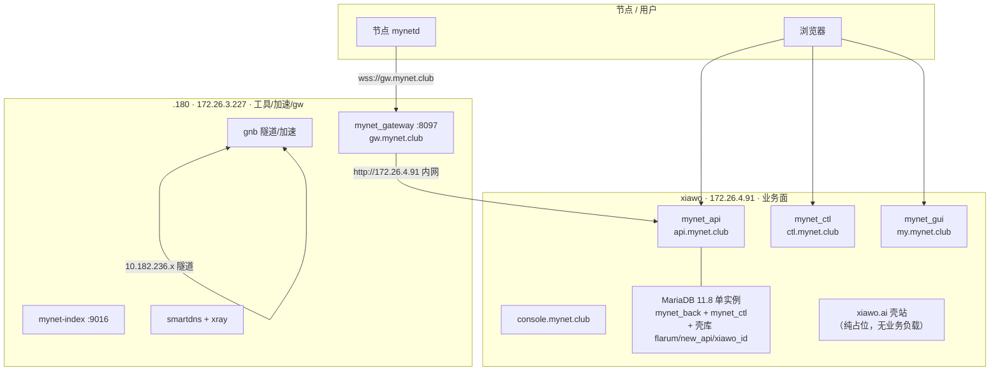

# 业务面迁移计划 —— .180 → xiawo（AWS 内网互通）

> 2026-11-03 拟。**状态：仅计划，未执行**。
> 裁定来源：用户 2026-11-03 —— 「mynet 业务、xiawo 业务都在 xiawo 实例；gw 入口还在 180；
> 找到他们的 AWS 内网，建立 AWS 内网通信。10.182.236.180 是 UDP 建立的 VPN 网络，不是内网。」

---

## 0. 裁定（用户拍板，2026-11-03）

| # | 裁定 | 内容 |
|---|---|---|
| **D1** | **业务面全上 xiawo** | `mynet_api` + `mynet_ctl` + `mynet_gui` + console 与既有 xiawo.ai 业务同居 `18.141.199.14` |
| **D2** | **gw 入口留 `.180`** | `mynet_gateway`（`gw.mynet.club` / WS / relay）不迁；上游 API 改走 AWS 内网 |
| **D3** | **库随业务迁** | `mynet_back`（api）+ `mynet_ctl`（ctl）两库 dump → xiawo MariaDB |
| **D4** | **用 AWS 内网互通，不用隧道** | `10.182.236.0/24` 是 gnb UDP 隧道网段，**不是** AWS 内网；机间控制面流量走 Lightsail VPC 私网 `172.26.0.0/20` |
| **D5** | **xiawo 的 proxy 出口职责待摘** | 业务上去后避免「业务+出口」双职复发 `.180` 的病（见 §5 风险 R3） |
| **D6** | **xiawo.ai 无真实业务，纯壳** | 既有 `*.xiawo.ai` 站点是空壳/占位，**不构成业务负载**；MyNet 业务是该机真正的业务面 |
| **D7** | **单 MariaDB 实例，不另起** | xiawo 现有 MariaDB 11.8 直接承接 `mynet_back` + `mynet_ctl`；与 `flarum`/`new_api`/`xiawo_id` 同实例不同库，**不跑第二个数据库进程** |
| **D8** | **废 `*.mynet.club` 泛解析** | 不再用泛域名；全部改**显式 A 记录**，一条一条配 |
| **D9** | **`gw` / `sub` / `xray` 留 `.180`，其余按需配 xiawo** | 工具面（gateway 入口、sub 订阅、xray）留加速机；业务域名（`api`/`ctl`/`my`/`console`/`www`/`adm`/`download`…）**按实际需要逐个**指到 `18.141.199.14` |
| **D10** | **DNS 现托管 GoDaddy（无 API），后续迁 Cloudflare** | `mynet.club` 当前在 GoDaddy 手工解析，**无 API**，切换靠控制台手工操作；迁移前后分两步：① 域名解析迁入 CF（与 `xiawo.ai` 同模式）② 开 CF 代理（橙云）加速 + **隐藏源站真实 IP** |
| **D11** | **`download.mynet.club` 跟 xiawo 走** | 静态分发随业务面迁 xiawo，不留在 `.180` |
| **D12** | **gateway→API 内网走 `http://172.26.4.91`** | AWS VPC 私网直连，**不上 TLS**——省握手/加解密开销；同账号同区域 Lightsail 私网隔离可接受（R4） |

---

## 1. 机器与网络现状（2026-11-03 实测取证）

### 1.1 两台 Lightsail（同区域 ap-southeast-1，同 VPC `172.26.0.0/20`）

| | `.180`（工具/加速 + gateway） | `xiawo`（业务面） |
|---|---|---|
| Lightsail 实例名 | `Mynet` | `xiawo` |
| 实例 ID | — | `i-0419c5f78b2cda5eb` |
| 公网 IP | `52.221.22.241` | `18.141.199.14` |
| **AWS 私网 IP** | **`172.26.3.227/20`** | **`172.26.4.91/20`** |
| hostname | `ip-172-26-3-227` | `ip-172-26-4-91` |
| 系统 | Debian 12 | Debian 13 (trixie) |
| 磁盘 | 40G（已用 34%） | 59G（已用 9%） |
| 内存 | **945Mi 总容量（可用 425Mi，swap 已用 361Mi）** | **1.9Gi ≈ 2G 总容量**（used 898Mi / available 1.0Gi） |
| gnb VPN VIP | `10.182.236.180` | `10.182.236.188` |
| SSH | `admin@52.221.22.241`（`~/.ssh/Aws.pem`） | `admin@18.141.199.14`（`~/.ssh/Aws.pem`） |

### 1.2 AWS 内网互通（**已通**，无需建隧道）

```
xiawo 172.26.4.91  ⇄  .180 172.26.3.227
  ping 3/3，rtt min/avg/max ≈ 0.16 / 0.18 / 0.27 ms
  traceroute 1 跳直达
  MTU 9001（ens5 jumbo frame）
```

**对照**：gnb 隧道（`10.182.236.180`⇄`.188`）rtt ≈ **84ms**。AWS 内网快 **约 400 倍**。
控制面（gateway→API、应用→DB）走 `172.26.x`，**不要**走 `10.182.236.x`。

当前端口探测（TCP，2026-11-03）：

| 目标 | 22 | 80 | 443 | 3306 | 8096/8097 |
|---|---|---|---|---|---|
| `.180:172.26.3.227` | 开 | — | 开 | — | 仅回环（`127.0.0.1`） |
| `xiawo:172.26.4.91` | 开 | 开 | 开 | 关（未暴露） | — |

⚠️ `.180` 的 mynetd/gateway 绑 **回环**（8096/8097），跨机调用不能打 `172.26.3.227:8097`，
要么改绑 `172.26.3.227`，要么 gateway 仍本机、只把 **API 上游** 指到 xiawo。本计划取后者（D2）。

### 1.3 现有服务清单

**`.180` 现役（迁移后角色）**

| 服务 | 端口/路径 | 迁后归属 |
|---|---|---|
| nginx（api/ctl/my/www/adm/…） | `172.26.3.227:443` | **迁走** → xiawo |
| MariaDB 10.11.19（`mynet_back` + `mynet_ctl`） | 127.0.0.1:3306 | **迁走** → xiawo |
| php8.4-fpm（api + ctl） | socket | **迁走** |
| mynet-queue（`queue:work`） | — | **迁走** |
| **mynet-gateway** | 127.0.0.1:8097 → `gw.mynet.club` | **留下**，上游改指 xiawo |
| **mynet-index**（gnb index） | 9016 | **留下** |
| mynetd | 8096 | **留下**（节点自身） |
| smartdns / smartxray / xray | 53 / 2088 / 10000+ | **留下**（加速/工具） |
| download.mynet.club | `/data/app/mynet.club/download` | **迁走** → xiawo（D11） |

**`xiawo` 现役（保持不动）**

| 服务 | 说明 |
|---|---|
| nginx（`*.xiawo.ai` 14 个站） | `/data/app/xiawo.ai/{bill,claw,docs,home,hub,id,shop,skill,www}` —— **纯壳/占位，无真实业务负载**（D6） |
| MariaDB 11.8.6 | 库：`flarum` / `new_api` / `xiawo_id`（壳库）；**迁移后同实例加 `mynet_back` + `mynet_ctl`**（D7） |
| php8.4-fpm | xiawo.ai 壳站 + 未来 MyNet 业务共用 |
| new-api（:3000） | AI 网关 |
| next-server（:3210） | Next.js |
| PM2（arena/chat 等） | Node |
| mynet_gnb + mynetd | 节点自身 |

**优势（相对 `.180` 挤爆的现状）**

| 项 | `.180` 现状 | `xiawo` 迁后 |
|---|---|---|
| 内存 | 945Mi，swap 361Mi，长期顶满 | **≈2G**，MyNet 业务上去后仍有余量 |
| 磁盘 | 40G / 34% | 59G / 9% |
| 数据库 | 独占一个 MariaDB 10.11 实例（两库） | **复用既有 MariaDB 11.8 单实例**，不跑第二个（D7） |
| 业务负载 | api + ctl + GUI + 加速 + gw 全挤一台 | 业务与加速/gw **分机** |

---

## 2. 目标态



**流量口径**

| 流 | 路径 | 网 |
|---|---|---|
| 节点 WS / relay | 节点 → `gw.mynet.club`（`.180` 公网）→ gateway | 公网 |
| gateway → API | `.180` → `172.26.4.91`（xiawo 私网） | **AWS 内网** |
| 用户 → 业务 | 浏览器 → DNS → `18.141.199.14`（xiawo 公网） | 公网 |
| 业务 → 库 | 同机 `127.0.0.1:3306` | 本机 |
| 节点间数据面 | gnb `10.182.236.x` | UDP 隧道 |
| 加速出口 | `.180` MASQ / proxy | 公网 |

---

## 3. 迁移步骤

### S0 — 前置取证（不改任何东西）→ ✅ **已完成（2026-11-03，见 §9）**

| # | 动作 | 证据要求 | 状态 |
|---|---|---|---|
| S0-1 | `.180` 库规模：`mynet_back` / `mynet_ctl` 行数与 dump 体积 | `information_schema.tables` + `mysqldump` 试跑体积 | ✅ 130表/67M + 16表/3.9M |
| S0-2 | `mynet_api` / `mynet_ctl` / `mynet_gui` 的 `.env` 全文（脱敏） | 落到工单，口令走 `crt` | ✅ 已取（无 Redis 依赖） |
| S0-3 | 两机 nginx server block 清单与证书路径 | 已有：`.180` `/etc/letsencrypt/live/mynet.club-0001/` | ✅ stream SNI 拓扑已明 |
| S0-4 | xiawo 既有 MariaDB 11.8 的 root/账号方案 | **不另起实例**（D7）；在现有实例内建 `mynet_back`/`mynet_ctl` 两库 + `mynet_admin` 专用账号 | ✅ 11.8.6，独立账号方案可行 |
| S0-5 | DNS 现状：`api`/`ctl`/`my`/`console`/`gw`/`download`/`www` 的 A 记录 | 明确哪些跟着业务走、哪些留下 | ✅ 全部 → `52.221.22.241` |
| S0-6 | xiawo 资源余量复核 | **≈2G 内存 + 纯壳负载（D6）**，预期充足；`free -h` + 现有 MariaDB `innodb_buffer_pool_size` 取证 | ✅ 1.0Gi avail，128M pool |

### S1 — AWS 内网通道固化 → ✅ **已完成（2026-11-03）**

| # | 动作 | 说明 | 状态 |
|---|---|---|---|
| S1-1 | 文档钉死私网地址（§1.1 表） | `172.26.3.227` ⇄ `172.26.4.91` | ✅ |
| S1-2 | gateway 上游 URL 改为内网 | `ExecStart` 中 `-upstream https://api.mynet.club` → **`-upstream http://172.26.4.91`**（D12）。备份 `mynet-gateway.service.bak-s1-20261103`。**已改文件、未重载** | ✅ 已暂存 |
| S1-3 | 双向放行 | iptables INPUT policy ACCEPT，无拦 172.26.x；双向 ping 0 丢包 rtt 0.2ms | ✅ |
| S1-4 | 验证 | `.180`→xiawo 私网 HTTP 带 Host 头 200/301；xiawo→`.180` 私网 HTTP 301；裸 IP 空回复属 nginx 无匹配 server block 正常 | ✅ |

⚠️ **硬提醒**：配置已暂存但 **gateway 进程仍在跑旧 upstream**（`https://api.mynet.club`）。
**S5 之前禁止 `daemon-reload` / `restart mynet-gateway`** —— 一重启就会去连 `172.26.4.91`，
而 MyNet API 还没迁到 xiawo，gateway 直接断。

### S2 — 库迁移 → ✅ **已完成（2026-11-03，初迁）**

| # | 动作 | 结果 |
|---|---|---|
| S2-1 | `.180` dump（`--single-transaction --no-tablespaces utf8mb4`） | `mynet_back` 6.2M gz · `mynet_ctl` 126K gz；备份 `/data/backup/mynet/s2-20261103/` |
| S2-2 | xiawo 建库 + `mynet_admin@127.0.0.1/localhost` | `mynet_back` + `mynet_ctl`，utf8mb4；账号权限 ALL |
| S2-3 | 导入 + 精确 COUNT 比对 | ✅ users=18 · nodes=74 · tenants=4 · node_keys=56 · sessions=102 · releases=204 · config_revisions=208 **全对齐** |
| S2-4 | ~~停写~~ | 初迁完成，尚未切流量；apps 仍在 `.180` 跑 |
| S2-5 | 增量补 dump | **待 S3 部署前再做一轮**（监控快照表持续写入） |
| S2-6 | 切 DB | **待 S3 应用上 xiawo 后**随部署切 `.env` |

**SHA256**：`mynet_back.sql.gz` = `1e0b4dd8…` · `mynet_ctl.sql.gz` = `8fbd3b6c…`（两端一致）

### S3 — 应用迁移 → ✅ **已完成（2026-11-03）**

| # | 动作 | 结果 |
|---|---|---|
| S3-1 | `mynet_api` → xiawo `/data/app/mynet.club/api` | 224M（含 vendor 85M），rsync 内网 @130MB/s |
| S3-2 | `mynet_ctl` → xiawo `/data/app/mynet.club/ctl` | 47M |
| S3-3 | `mynet_gui` `dist/spa` → xiawo `/data/app/mynet.club/my` | 4M |
| S3-4 | console SPA 随 api 走 | `public/console` 在 api 内 |
| S3-5 | xiawo nginx server block：api / console / my / ctl / download / www / adm | 全部 `443 ssl` + 自签 `*.mynet.club`；HTTP→HTTPS 重定向 |
| S3-6 | 证书 | 自签 `*.mynet.club`（`/etc/ssl/mynet/`）；**CF SSL 模式设为 `full`**（接受自签）；后续可升 Full(strict) + 真证书 |
| S3-7 | `.env` 调整 | api `MYNET_GATEWAY_URL` → `http://172.26.3.227:8097`（D12，S5 生效） |
| — | download | **1.8G** 全量迁移完成（含 gnb/tools/wireguard 二进制分发） |

**本地验证**：`api`/`my`/`ctl`/`download`/`console`/`www` **6 站全 200**。

### S4 — DNS 切换（D8/D9/D10）

**现状**：`mynet.club` 在 **GoDaddy**，无 API，只能控制台手工改。目标：迁 **Cloudflare** 后开代理（橙云），加速 + **隐藏源站 IP**。

**两条路径，推荐 A（先迁 CF，再切记录）：**

| | 路径 A（推荐） | 路径 B |
|---|---|---|
| 顺序 | **先迁 CF → 在 CF 里建显式记录 → 切 NS** | 留 GoDaddy，手工改 A 记录 |
| 优点 | 一次搬家；后续改解析有 API/秒生效；橙云保护 IP | 改动少、快 |
| 缺点 | NS 切换有传播期；要先配好全部记录 | 手工改、无 API、源站 IP 一直暴露 |

#### S4a — 迁 Cloudflare（路径 A 前置，可与 S1–S3 并行）

| # | 动作 | 说明 |
|---|---|---|
| S4a-1 | CF 添加 `mynet.club` zone | 与 `xiawo.ai` 同账号；凭证已有 `CF_GLOBAL_KEY`（`arthur/cert/ssl`） |
| S4a-2 | CF 里**逐条**建显式 A/AAAA 记录（D8，无 `*`） | 先按**现状指向** `52.221.22.241` 建齐，确认无漏 |
| S4a-3 | 证书策略定档 | ① CF 代理模式下 CF 终结 TLS（Universal SSL）② 或 Full(strict) + 源站证书；**推荐先 ①** |
| S4a-4 | GoDaddy 改 NS → CF 分配的 nameserver | 传播 5min–48h；TTL 先调短 |
| S4a-5 | 验证：`dig NS mynet.club` 走 CF；各子域解析不变 | **此时流量路径已变**（若开橙云）：用户 → CF → 源站 |
| S4a-6 | 按需开橙云（代理） | 业务域名开；`gw`/`sub`/`xray` **视协议特性决定**（见下） |

⚠️ **`gw` / `sub` / `xray` 开橙云要单独评估**：
- `gw.mynet.club` 是 **WebSocket**——CF 支持 WS，可用
- `sub` / `xray` 若涉及非 HTTP 协议或 Reality 伪装，**不能走 CF 代理**，必须灰云（仅 DNS）+ 源站直连
- Reality 的 SNI 伪装（`www.cloudflare.com`）打到 `.180` 的 stream 层，**与 CF 代理无冲突**（它不走 `xray.mynet.club` 域名）

#### S4b — 业务记录切到 xiawo（在 CF 内执行）

| 顺序 | 记录 | 新指向 | 归属 | 橙云 |
|---|---|---|---|---|
| 1 | `ctl.mynet.club` | 18.141.199.14 | 业务 → xiawo | 可开 |
| 2 | `my.mynet.club` | 18.141.199.14 | 业务 → xiawo | 可开 |
| 3 | `console.mynet.club` | 18.141.199.14 | 业务 → xiawo | 可开 |
| 4 | `api.mynet.club` | 18.141.199.14 | 业务 → xiawo（**最后切**） | 可开（注意 WS/长连接） |
| 5 | `www` / `adm` / `download` | 18.141.199.14 | 业务 → xiawo（D11） | 可开 |
| — | `gw.mynet.club` | 52.221.22.241 | **留 `.180`**（D9） | **建议灰云**（WS/直连稳定优先） |
| — | `sub.mynet.club` | 52.221.22.241 | **留 `.180`**（D9） | **必须灰云**（非 HTTP 特性） |
| — | `xray.mynet.club` | 52.221.22.241 | **留 `.180`**（D9） | **必须灰云** |

⚠️ **切完后确认泛解析已摘**（D8）：留着 `*` 会把没列到的子域静默打到旧机，掩盖漏配。

### S5 — gateway 上游切换 → ✅ **已完成（2026-11-03）**

| # | 动作 | 结果 |
|---|---|---|
| S5-1 | gateway `-upstream` → **`http://172.26.4.91`**（D12） | 已激活（S1 暂存配置生效） |
| S5-1b | gateway `-listen` → **`172.26.3.227:8097`**（私网口） | + **`-internal-token`**（非回环监听强制要求，防 `/v1/notify` 被任意推送） |
| S5-1c | API 侧 `MYNET_GATEWAY_TOKEN` 同步 | xiawo `.env` 已配 |
| S5-1d | nginx `gw.mynet.club` `proxy_pass` → `172.26.3.227:8097` | 已改 |
| S5-1e | xiawo 加内网 HTTP 入口 | `listen 172.26.4.91:80` 不跳 HTTPS（D12 http 内网） |
| S5-2 | 节点 WS 不动（仍 `wss://gw.mynet.club`） | ✅ **5/5 节点回连** |
| S5-3 | 回灌验证 | `gw.mynet.club/healthz` 200 · gateway→API 内网 HTTP 200 |

### S6 — 收尾

| # | 动作 |
|---|---|
| S6-1 | `.180` 下线 api/ctl/gui/nginx 业务 block、php-fpm 池、mynet-queue |
| S6-2 | `.180` MariaDB 保留只读备份 ≥7 天，再议退役 |
| S6-3 | xiawo 摘 proxy 出口职责（D5）或降权；加速出口收敛 `.180` |
| S6-4 | 更新 `deployment-registry.md` + 本文档状态 |
| S6-5 | 更新凭证库：`arthur/misc/ssl` 等条目的 host 字段 |

---

## 4. 验证判据

| # | 判据 | 通过标准 |
|---|---|---|
| A1 | 私网互通 | `172.26.4.91 ⇄ 172.26.3.227` ping 0 丢包、rtt <1ms |
| A2 | API 可用 | `https://api.mynet.club/up` 200（DNS 已切） |
| A3 | GUI 可用 | `https://my.mynet.club` 登录页 200 |
| A4 | ctl 分发 | `https://ctl.mynet.club/d/apps.json` 200 |
| A5 | console | `https://console.mynet.club` 200 |
| A6 | **gateway 不断** | `wss://gw.mynet.club/v1/node/connect` 节点在线、心跳持续 |
| A7 | gateway→API 内网 | `.180` 上 gateway 日志显示 upstream 为 `172.26.4.91`，无公网回环 |
| A8 | 节点命令闭环 | 下发一条命令，节点收到并回报 |
| A9 | 加速面未回归 | `.180` proxy/gnb/xray 正常；加速域解析不变 |
| A10 | xiawo.ai 壳站未受影响 | 既有 14 站抽检 200（壳站也应保持可达） |

---

## 5. 风险与待裁定

| # | 风险 | 影响 | 处置 |
|---|---|---|---|
| **R1** | ~~xiawo 内存不足~~ **已降级** | — | **D6/D7 后不再成立**：xiawo.ai 纯壳无负载 + 2G 内存 + 单库实例；MyNet 业务是该机主负载，余量充足 |
| **R2** | MariaDB 10.11 → 11.8 版本差异 | SQL 兼容 / 权限串扰 | **同实例不同库**（D7）：独立用户、独立库，禁共用 root；导入前试跑关键查询；字符集统一 `utf8mb4` |
| **R3** | xiawo 仍是 proxy 出口（`xiawo-gnb-e1`） | 业务+出口双职 | **D5**：业务稳定后摘出口或降权；`.180` 独占加速 |
| **R4** | ~~gateway 上游明文内网~~ **已裁（D12）** | — | http 内网直连；同 VPC 同账号隔离可接受 |
| **R5** | `manage-prod.sh` rsync `--delete` 会删线上目录 | 删掉 xiawo.ai 壳站文件 | **禁 `--delete`**；或专用目录、专用部署脚本 |
| **R6** | DNS 逐步切期间新旧混跑 | 双写、会话错乱 | 切 `api` 前先停 `.180` 写；TTL 调短（300s） |
| **R7** | MariaDB 11.8 SQL mode / 保留字漂移 | 隐性查询失败 | dump 导入后跑关键 API 冒烟 + `make check` 等价验证 |
| **R8** | 证书到期 2026-12-11 | 迁移后不久即到期 | 迁移时一并重签（DNS-01，CF）或改用 CF Universal SSL |
| **R9** | GoDaddy 无 API，DNS 手工操作 | 改错/漏改/回滚慢 | 推荐路径 A（迁 CF 后有 API）；每步 `dig` 复核 |
| **R10** | 开橙云后源站 IP 仍暴露（历史 DNS/证书/直连） | 保护失效 | 开橙云后收口：源站防火墙只放 CF IP 段；检查历史 A 记录缓存 |

**待裁定**

| # | 问题 | 状态 |
|---|---|---|
| ~~T2~~ | ~~`sub`/`client`/`xray` 站点归属~~ | ✅ **已裁（D9）**：`gw`/`sub`/`xray` 留 `.180`；其余按需逐个配 xiawo |
| ~~T3~~ | ~~泛解析策略~~ | ✅ **已裁（D8）**：废泛解析，全显式记录 |
| ~~T1~~ | ~~`download.mynet.club` 跟谁走~~ | ✅ **已裁（D11）**：跟业务走 xiawo |
| ~~T4~~ | ~~gateway→API 用 http 还是 https 内网~~ | ✅ **已裁（D12）**：http，省消耗 |
| **T5** | xiawo 出口职责何时摘、摘到哪 | 见 R3 / D5 |

---

## 6. 回滚

| 阶段 | 回滚动作 | RTO |
|---|---|---|
| S1 仅配置未重载 | 丢弃配置 diff | 即时 |
| S2 库已导入未切 | DROP xiawo 新库；`.180` 库原样 | 分钟 |
| S3 应用已上未切 DNS | 停 xiawo 新站点；`.180` 不动 | 分钟 |
| S4 DNS 已切 | 改回 A 记录（TTL 300） | 5–30 分钟 |
| S5 gateway 已切上游 | `-upstream` 改回 `https://api.mynet.club` | 分钟 |
| S6 `.180` 已下线业务 | 重新 enable 服务（代码/库仍在） | 小时 |

**硬底线**：S4 切 `api.mynet.club` 之前，`.180` 的 api/ctl/库**一律不删**。

---

## 7. 参考

| 文档 | 用途 |
|---|---|
| [deployment-registry.md](../deployment-registry.md) | 部署清单 SSOT |
| [node-upgrade-plan-180-182.md](node-upgrade-plan-180-182.md) | 既有 `.180` 角色口径 |
| [prod-cutover-20260926.md](../archive/2026-09/prod-cutover-20260926.md) | api 切换历史 |
| [proxy-split.md](proxy-split.md) | proxy server/client 分工 |
| 凭证库 `arthur/cert/ssl` | CF `CF_GLOBAL_KEY` + `CF_ZONE_ID_XIAWO_AI`（D10 迁 `mynet.club` 可复用同账号） |
| 凭证库 `arthur/misc/ssl` | 现网证书元数据（`mynet.club-0001`，到期 2026-12-11） |
| 凭证库 `arthur/proxy/xray-sg` | `.180` 加速面 |

---

## 8. 窗口记录

| 日期 | 阶段 | 结果 | 记录人 |
|---|---|---|---|
| 2026-11-03 | 计划成文 + 私网取证 | 私网已通（rtt 0.2ms）；服务清单齐；**未改任何生产配置** | — |
| 2026-11-03 | 用户修正 D6/D7 | xiawo.ai 纯壳无业务 + 单 MariaDB 实例 + 2G 内存 → R1/R2 降级 | — |
| 2026-11-03 | 用户裁定 D8/D9 | 废泛解析、全显式记录；`gw`/`sub`/`xray` 留 `.180`，其余按需配 xiawo | — |
| 2026-11-03 | **S0 取证完成** | 见 §9；**未改任何生产配置** | — |
| 2026-11-03 | 用户补 D10 | `mynet.club` 在 GoDaddy（无 API）；后续迁 CF 加速 + 隐藏源站 IP | — |
| 2026-11-03 | 用户裁 D11 | `download.mynet.club` 跟 xiawo 走 | — |
| 2026-11-03 | 用户裁 D12 | gateway→API 内网走 http，省消耗 | — |
| 2026-11-03 | **S4b 橙云已开** | CF NS 已切换完成（S4a 提前落地）；8 业务域开橙云、`gw`/`sub`/`xray`/`client` 保持灰云；`api.mynet.club` 解析已到 CF IP | — |
| 2026-11-03 | **S1 内网通道固化完成** | 私网双向 rtt 0.2ms、HTTP 通；gateway upstream 已暂存改 `http://172.26.4.91`（未重载，S5 前禁 restart） | — |
| 2026-11-03 | **S2 库迁移完成（初迁）** | `mynet_back`+`mynet_ctl` 已导入 xiawo MariaDB 11.8；关键业务表精确 COUNT 全对齐；apps 仍在 `.180` 跑 | — |
| 2026-11-03 | **S3 应用迁移完成** | api/ctl/my/download 全量上 xiawo（224M+47M+4M+1.8G）；nginx 6 站全 200；CF SSL=full | — |
| 2026-11-03 | **S4b DNS 切换完成** | 8 业务域 A 记录 → `18.141.199.14`（橙云）；`gw`/`sub`/`xray` 留 `.180`（灰云）；全站 200 | — |
| 2026-11-03 | **S5 gateway 切换完成** | gateway 绑私网 `172.26.3.227:8097` + `internal-token` + upstream `http://172.26.4.91`；5 节点回连；`gw.mynet.club` 200 | — |

---

## 9. S0 取证结果（2026-11-03，只读）

### 9.1 库规模（`.180`，经 `mynet_admin` 只读查询）

| 库 | 表数 | 磁盘 | 说明 |
|---|---|---|---|
| `mynet_back` | **130** | **67M** | api 主库（现网 121 表 + 后来补表） |
| `mynet_ctl` | **16** | **3.9M** | ctl 分发库 |
| `mynet` | 159 | — | **历史退役库**，是否随迁待定（建议不迁） |

行数 Top（`mynet_back`）：`node_monitor_snapshots` 266k · `role_permissions` 344 · `node_peer_connections` 231 · `monitor_rt_cmds` 164 · `personal_access_tokens` 136 · `user_sessions` 131 · `config_revisions` 130。

**结论**：体量很小（合计 ≈71M），dump/导入窗口短，风险低。

### 9.2 应用 `.env` 要点（已脱敏）

| 键 | api | ctl | 迁移影响 |
|---|---|---|---|
| `DB_*` | `mynet_back` @ `127.0.0.1:3306`，`mynet_admin` | `mynet_ctl` @ 同 | 迁后仍 `127.0.0.1`（xiawo 本机） |
| `CACHE_STORE` | `database` | `database` | **无 Redis 依赖** ✅ |
| `QUEUE_CONNECTION` | `database` | — | 队列在库里，随 dump 走 ✅ |
| `SESSION_DRIVER` | `database` | `database` | 同上 ✅ |
| `MYNET_GATEWAY_URL` | `http://127.0.0.1:8097` | — | **迁后改** `http://172.26.4.91`（D2/D4） |
| `MYNET_BACK_API_URL` | — | `https://api.mynet.club` | DNS 切后自动跟 |
| `BROADCAST_CONNECTION` | `reverb`（值多为空） | — | Rever 未实装，暂忽略 |
| `SANCTUM_STATEFUL_DOMAINS` | 含 `my.mynet.club` 等 | — | console 部署时要核 |
| 证书 | `/etc/letsencrypt/live/mynet.club-0001/` | — | SAN=`*.mynet.club, mynet.club`，**到期 2026-12-11** |

⚠️ **`.env` 含明文 DB 口令**——属 Laravel 常态，但本次已进会话上下文；后续操作一律 `crt` / 机内读取，不再回显。

### 9.3 `.180` nginx 拓扑（**关键发现**）

```
公网 443
  └─ nginx stream（SNI preread）──────────────────┐
       ├─ SNI www.cloudflare.com / www.apple.com ──→ xray Reality 127.0.0.1:18443
       └─ default（网站 SNI）──────────────────────→ nginx https 127.0.0.1:12443
                                                     ├─ api / ctl / my / www / adm / download…
                                                     ├─ gw / sub / xray（留 .180，D9）
                                                     └─ client / dns / openclaw / stage*
```

- `stream.d/reality-sni.conf`（2026-10-26）：**外部 443 统一由 stream 接管**
- 站点块全部 `listen 127.0.0.1:12443 ssl`
- **含义**：`.180` 的 443 入口是「加速/Reality 复用 + 网站」一体——迁移业务后 **stream 层必须留 `.180`**（它是 xray Reality 入口，D9 工具面）；xiawo 侧是**直连 443**（已有 `0.0.0.0:443`），不需要 stream 层

### 9.4 DNS 现状（S0-5）

**全部子域**（api/ctl/my/console/gw/download/www/adm/sub/xray/client + `mynet.club`）当前均解析到 **`52.221.22.241`**（`.180`）。
未见独立显式记录差异——大概率靠泛解析或统一 A 记录。**D8 废泛解析后须逐条建显式记录**。

### 9.5 xiawo 资源与库（S0-4 / S0-6）

| 项 | 值 | 评估 |
|---|---|---|
| MariaDB | **11.8.6**（Debian 13） | 与 `.180` 10.11.19 有版本差（R7） |
| 现有业务库 | `flarum` / `new_api` / `xiawo_id`（壳） | 单实例加库即可（D7） |
| 现有 DB 账号 | `xiawo_id@127.0.0.1` / `new_api_user@127.0.0.1` | 新建 `mynet_admin`，**不复用** |
| `innodb_buffer_pool_size` | **128MB**（默认值） | 承接 67M 库够用；可调到 256–512M |
| 内存 | 1.9Gi **总容量**；used 898Mi，**available 1.0Gi**（可再分配余量） | 充足 |
| 磁盘 | 59G / **4.6G used（9%）** | 充足 |
| 443 入口 | nginx 直连 `0.0.0.0:443` | 比 `.180` 简单，无需 stream |
| certbot | 仅 `api.xiawo.ai` | **需新签/迁 `*.mynet.club`** |
| php-fpm | 单池 `www.conf` | MyNet 业务可共用或加池 |

### 9.6 S0 遗留

| # | 事项 | 处置 |
|---|---|---|
| 1 | `mynet` 历史退役库（159 表）是否随迁 | **建议不迁**，留 `.180` 只读备份即可；待 T1 一并裁 |
| 2 | `.180` MySQL root 口令未在 vault 见独立条目 | dump 走 `mynet_admin` 即可；root 口令管理另议 |
| 3 | `download.mynet.club` 归属（T1） | 仍待裁 |
| 4 | 证书：`.180` 有 `*.mynet.club`，xiawo 只有 `api.xiawo.ai` | S3-6 要新签或迁 |
