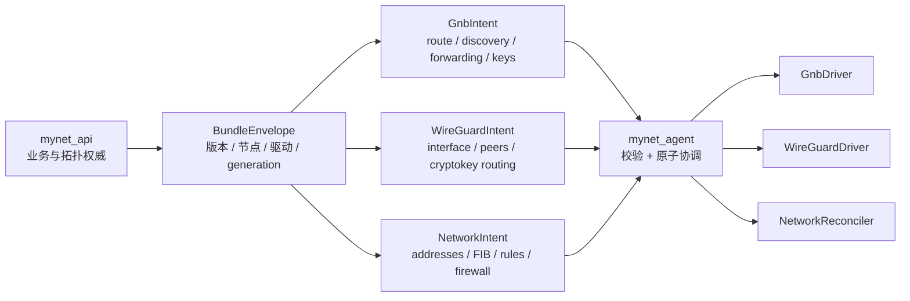

# SPEC: VPN Driver 抽象层（driver-abstraction）

> 更新：2026-09-21 | 适用：`mynet_agent`（实现）、`mynet_api`（配置生成）
> 来源规划：`integration-plan-v2.md` §3 W2
> 状态：**设计稿**（P0 交付；P1 落接口壳）

---

## 1. 目的

让「数据面驱动」可替换：把 gnb 特有物收敛到驱动边界，使未来切换到 wireguard 的成本 =
**写一个 driver + 注册**，而不是满仓改。

同时把配置的**抽象**（想连谁、走哪些网段）与**具体格式**（gnb 的 `node.conf` / wg 的 `wg set`）拆开。

---

## 2. 现状

### 2.1 已有的接缝 ✅

`mynet_agent/internal/domain/vpn_driver.go` 已定义：

```
VPNDriverType  = "gnb" | "wireguard"
VPNDriver      = { GetDriverType, IsAvailable, IsProcessAlive,
                   GetAllPeers, GetOnlinePeers, GetPeer, GetLocalPeer,
                   GetNetworkSummary, Refresh }
VPNDriverFactory = { CreateDriver, DetectDriver }
```

**接缝存在，但只覆盖「读」**（peers/status）。配置写入、生命周期、格式转换仍在接缝之外。

### 2.2 仍硬绑 gnb 的四处 ❌

| # | 泄漏点 | 位置 | 症状 |
|---|--------|------|------|
| **L1** | 配置包生成 gnb 原生格式 | `back` config-bundle → `files["node.conf"/"address.conf"/"route.conf"]` | back 必须知道 gnb 文件格式 |
| **L2** | 热重启机制 | `agent`：`gnb_ctl -b gnb.map -w core.flag=2`，回落 SIGHUP，再冷启 | 重载逻辑写死 gnb 工具链 |
| **L3** | 分发产品名 | `ctl` manifest 的 `gnb` 条目、`conventions.md` 产品表 | 无 wireguard 产品位 |
| **L4** | 格式定义 | `spec/data-models.md` §4/§9 | 抽象与 gnb 原生混写在一节 |

---

## 3. 设计修正：公共控制面 + 驱动专属意图

> 2026-09-21 深读 `mynet_gnb` 源码、补丁文档与本机 WireGuard Tools 后，
> **撤销原来的“一个扁平 VPNBundle 覆盖两种驱动”设计**。原设计把 GNB route
> 机械等同为 WireGuard AllowedIPs，语义错误。



### 3.1 可以共用的只有外壳

```json
{
  "schema_version": 2,
  "generation": "opaque-stable-version",
  "driver": "gnb",
  "node": {
    "id": "business-node-id",
    "interface": "gnb_tun_178",
    "mtu": 1450
  },
  "network": {
    "addresses": ["10.182.236.178/24"],
    "routes": [],
    "rules": []
  },
  "gnb": {},
  "wireguard": null
}
```

公共层只表达：业务节点、接口意图、操作系统网络状态和契约版本。`node.id` 是
**业务标识**；不得宣称它等同 WireGuard 公钥身份。

### 3.2 GNB 专属意图

GNB 有四种彼此独立的身份/位置：

| 概念 | 真实语义 | 来源 |
|---|---|---|
| `nodeid/uuid64` | 逻辑节点主键 | `node.conf` / `route.conf` |
| Ed25519 key | 安全身份；与对端做 key exchange | `security/`、`ed25519/` |
| TUN IP/网段 | 虚拟路由身份 | `route.conf` |
| WAN endpoint | 动态传输位置，可随 NAT 变化 | index push、DETECT、PING/PONG、DNS、cache |

建议的 `gnb` 块：

```json
{
  "gnb": {
    "identity": {
      "node_id": "3722810996882027",
      "private_key_ref": "secret://...",
      "public_key": "64-hex",
      "peer_public_keys": {"peer-id": "64-hex"}
    },
    "listeners": ["0.0.0.0:9016"],
    "routes": [
      {"node_id": "peer-id", "prefix": "192.168.0.0/24", "source": "lan"}
    ],
    "discovery": {
      "index_servers": ["52.221.22.241:9016"],
      "static_nodes": [],
      "forward_nodes": []
    },
    "forwarding": {
      "direct": true,
      "standard": true,
      "unified": "auto",
      "proxy": false,
      "relay_routes": []
    },
    "options": {
      "multi_socket": true,
      "safe_index": true,
      "passcode_ref": null
    }
  }
}
```

关键约束：

1. `route.conf` 不只是普通 FIB：它同时创建节点、绑定虚拟 IP/网段、构成准入/准出
   白名单，并可定义节点环和 relay 路径。
2. `address.conf` 只能给 `route.conf` 已创建的节点附加角色和初始 endpoint。
3. index 类似 tracker：注册/查询 NAT 后 endpoint；普通数据面仍优先 P2P。
4. P2P 失败后可 Standard Forwarding、显式 Relay 或 Unified Forwarding；中继保持
   GNB payload 的端到端保护，不等同 WireGuard hub。
5. `proxy on` 是本仓 P2 补丁能力：准出无 route 时兜底到**指定出口节点**（下一跳，等同 route.conf）、准入跳过白名单。
   **必须由目标二进制 build capabilities 声明，不能只看 driver 名推断。**

### 3.3 WireGuard 专属意图

WireGuard 的协议身份是 Curve25519 静态公钥，Endpoint 只是可变的传输位置。
认证包会让内核学习最新 Endpoint（roaming），这不是成员发现或 NAT 打洞协议。

```json
{
  "wireguard": {
    "interface": {
      "private_key_ref": "secret://...",
      "public_key": "base64-32-byte-key",
      "addresses": ["10.20.0.2/32", "fd00:20::2/128"],
      "listen_port": 51820,
      "fwmark": null
    },
    "peers": [
      {
        "id": "business-peer-id",
        "public_key": "base64-32-byte-key",
        "preshared_key_ref": null,
        "bootstrap_endpoint": "vpn.example.com:51820",
        "allowed_ips": ["10.20.0.1/32", "192.168.10.0/24"],
        "persistent_keepalive_seconds": 25
      }
    ],
    "routing": {
      "mode": "managed",
      "table": "auto"
    }
  }
}
```

关键约束：

1. `AllowedIPs` 是**双向 cryptokey routing**：出站按目的前缀选公钥；入站只接受
   该公钥声明前缀内的源地址。它不是普通系统路由，也不等同 GNB route。
2. Interface Address、MTU、系统 route/rule/firewall 不属于 `wg setconf/syncconf`
   管理范围，必须由 `NetworkReconciler` 独立协调。
3. `PersistentKeepalive` 是 per-peer NAT 映射保活，不是发现、中继或健康检查。
4. `bootstrap_endpoint` 是初始提示；运行时 learned endpoint 只进 Status，不回写期望配置。
5. peer 删除必须从内核设备删除；公钥变化等价于删除旧 peer、新增新 peer。
6. 同接口 AllowedIPs 精确重复必须拒绝，重叠默认拒绝或显式告警。
7. WireGuard 没有 GNB index、打洞、transparent forward/relay、proxy 的等价功能。

### 3.4 不允许再做的一一映射

| 错误映射 | 为什么错 |
|---|---|
| `node.id` → WireGuard 公钥指纹 | 业务 ID 与协议身份生命周期不同 |
| GNB `route.conf` → WG `AllowedIPs` | 后者还承担入站源地址授权，且是最长前缀 cryptokey routing |
| GNB index → WG Endpoint | index 是 rendezvous/地址目录；Endpoint 只是某 peer 的初始位置 |
| GNB proxy/relay → WG hub | WG hub 会解密并重新加密两条独立会话，不是透明端到端 relay |
| GNB Ed25519 hex → WG key | WG 使用 Curve25519、32 字节 Base64；格式和算法均不同 |
| GNB 热重启 → `wg syncconf` | syncconf 仅同步 WG 协议状态，不同步地址/FIB/rule/firewall |
| `{network,netmask}` 通用路由 | 对 IPv6 不自然，也无法表达 table/metric/policy |

### 3.5 驱动接口与能力必须拆细

`WriteConfig()` 应升级为“验证并协调一个 driver-specific intent”，而非假定所有字段通用。

```
VPNDriver
  + Capabilities() DriverCaps
  + Validate(envelope) error
  + Apply(envelope) error
  + Start() error
  + Stop() error
  + Reload() error
  + Status() (*DriverStatus, error)
```

`DriverCaps` 至少拆为：

- `peer_hot_update`
- `interface_crypto_hot_update`
- `network_state_reconcile`
- `endpoint_roaming`
- `endpoint_discovery`
- `nat_traversal`
- `transparent_relay`
- `driver_proxy`
- `dynamic_dns_refresh`
- `custom_key_upload`

单个 `hot_reload/discovery/proxy` 布尔值会给调用方过度承诺。

---

## 4. 代码实测后的真实现状

| # | 实测 | 影响 |
|---|---|---|
| **D1** | `mynet_gnb/packages/p1-hot-restart-v2` 已实现并实测 `SIGHUP` / `gnb_ctl -w core.flag=2`，PID 不变并继承 TUN 与 UDP sockets；P2 实现 `proxy on`；CI 发版按 P1→P2→P3 应用补丁 | agent 不能再写“热重启不存在”。但能力取决于**实际发布二进制是否带补丁**，须探测版本/build capability |
| **D2** | agent 已有 `VPNBundle`、`GNBDriver.WriteConfig` 和测试，但生产调用为 0；config-bundle 也没有 agent client | 新链是死代码，不能宣称 S6 完成 |
| **D3** | 当前生产链仍是 `node.refresh` / `route.refresh` 分散拉取文本、分别写盘、冷重启；`address.conf` 无运行时刷新 | 迁移必须建立原子 bundle、generation、last-known-good，不能直接接上新写入者 |
| **D4** | `node.conf` 至少 3 个写入者；`route.conf` 至少 2 个；keys 也有多写者，last-writer-wins | 先收敛配置写入权，再接 bundle |
| **D5** | GNBRunner 有实现但生产零调用；应用层 StartNode 是返回 nil 的占位；系统服务/命令链/PID 文件并存 | 生命周期没有唯一权威 |
| **D6** | ctl `ConfigPackService` 消费旧 `files/keys.ed25519/keys.security`，且请求 `/api/v2`；back 当前模块路由是 `/api/v1` | 新旧契约尚未贯通，成功响应也可能产空 ZIP |
| **D7** | back route 数据混合 `node_ip/vpn_ip/lan_ip/wan_ip/endpoint_ip`；旧 GNB renderer 一律写固定 `/24` | 不能机械生成 WG AllowedIPs；也需修正 GNB route 数据模型 |
| **D8** | `mynet_gnb/src` 本身含一条可疑热重启路径；生产发布语义来自 CI 打补丁后的产物 | 测试必须针对发布二进制，不可只读源码树推断 |

密钥与落盘仍需遵守：GNB `security/*.private` 0600；WireGuard private key/PSK 不得
进入命令行、日志或普通状态 dump。

---

## 5.1 接口名单权威（`node.interface`）—— 2026-10-01 定稿

**只有一个字段是权威**：`node.interface`。back 侧来源是 `node_configs.config.ifname`
（每节点事实；一台主机可能多个 zone 共存 —— 现网网关 182 的隧道口是 `gnb_tun_16`，
`gnb_tun` 被另一个 zone 占用），缺省时取驱动声明的默认名（`vpn.gnb…ifname.default`）。
`gnb.options.ifname` 是**过渡期别名**：back 两处发同一个值，老 agent 只读后者。

节点侧统一走 `domain.BundleEnvelope.TunDevice()`（`shared/domain/bundle_envelope.go`）：
权威缺失 → 暂用别名；两者都有值且不等 → **报错**；名字超 15 字符或含
`[A-Za-z0-9._-]` 之外的字符 → **报错**。投影（`project_active.go` / `cmd_refresh.go`
的 refresh-config）、OS 路由（`planFromBundle` 校验 `routes[].dev`）、proxy 策略路由
（`ProxyRuntime.TunDevice`）、metrics（`gnbIfnameFromBundle`）**全部只经这一个解析口**。

**阻断性配置一律不回退默认名**（用户裁定 2026-10-01）。理由不是洁癖而是失败形态：
默认名在单 zone 机器上能用，在 182 这类机器上恰好是别人的接口，而
`ip route … dev X` 只要 X 存在就执行成功 —— 回退等于把整台机器的流量搬进另一条隧道，
**且不报错**。宁可 apply 失败、错误可见、该节点停在上一版配置。
（local 模式例外：没有 back 参与，`driver.WriteIntent` 允许空 ifname 由 gnb 自己决定。）

两步走的顺序是硬约束，不能颠倒：

| 步 | 动作 | 出口判据 |
|---|---|---|
| **B-1**（已完成） | back 单源取值 + 写入门禁（`NodeConfig` 的 `saving`）+ 发布硬失败 + **读侧复用同一算法**（GUI 网络配置回显、`quickCreateNode` 不再种子常量）；agent 建立 `TunDevice()` 权威、仍**同时**发/容 `gnb.options.ifname` | `BundleEnvelopeGnbContractTest`（写入拒绝 422 / 脏值拒发布 / 缺省用默认名）+ `NodeIfnameAuthorityTest`（字段级写路径真的落库、读侧与 bundle 同源、wg 主驱动取 `wg0`）+ `bundle_envelope_tun_device_test.go` + `plan_device_test.go` |
| **B-2**（待发版后） | back 停发 `gnb.options.ifname`，schema 里删该字段 | 现网 agent 全部 ≥ 带 `TunDevice()` 的版本；否则 182 这类机器会退回 gnb 默认名（= 事故复现） |

---

## 5. 修订后的落地顺序

| 步 | 动作 | 出口判据 |
|---|---|---|
| **R0** | 冻结当前生产链；撤销错误的扁平 VPNBundle 草案 | back/agent/ctl 不再宣称 S6 完成 |
| **R1** | 建立发布二进制 capability 探测：GNB P1/P2/P3、WG tools/kernel 特性 | 能力来自实测而非 driver 名 |
| **R2** | 定义 `BundleEnvelope + NetworkIntent + GnbIntent + WireGuardIntent` schema v2 | JSON Schema + 双端 fixture 可互解 ✅ **2026-09-22**：`spec/schemas/bundle-envelope-v2.schema.json` + 7 fixtures；Go `internal/domain/bundle_envelope.go` 与 PHP `App\Modules\VPN\Domain\Bundle` 互解，checksum 一致 |
| **R3** | 修正 back 业务模型：区分 interface address、advertised prefix、WAN/endpoint、peer relationship、relay/topology、key algorithm | 不再从混合 route 列表猜语义 ✅ **2026-09-22**：`NetworkSemanticsProjector` + 六类 VO；CPI-22 修复 ip_type 分类；明文私钥不进投影 |
| **R4** | agent 建原子 Apply：stage→validate→write→reload→health-check→commit/rollback；保存 generation 与 last-known-good | 任一步失败不留下半套配置 ✅ **2026-09-22**：`internal/coordinator`（Applier + FuncWriter + journal + 锁）；注入 write/reload/health-check 失败均回滚；`last-known-good.json` + `current_generation`；journal 不含明文私钥。旧 refresh 委托 Apply 属 R5 |
| **R5** | 收敛配置写入权与生命周期权威；旧 node/route refresh 改为委托 Apply | 每种文件只有一个写入者 ✅ **2026-09-22**：唯一写入口 `coordinator.ApplyFiles`；node/route/address refresh + `GNBDriver.WriteConfig` + `GNBRunner.EnsureConfig` 均已收敛；进程生命周期权威 = `node.GNBRunner`。完整 `BundleApplier.Apply(envelope)` 委托待 R8 有 Envelope 下发后接线 |
| **R6** | 实现 GNB adapter，完整保留 node.conf 选项、route 节点环/relay、address 角色、keys、P1/P2 能力 | 与现生产链行为对照通过 ✅ **2026-09-22**：`coordinator.GnbAdapter`（Envelope→node/route/address/ed25519/security）；生产形状单测锁定（daemon off / proxy on / i\|0\|host\|port / id\|ip\|mask / 私钥 0600）；via/proxy_fallback 注释段。热重启 Reload 待接 GNBDriver（P1） |
| **R7** | 实现 WireGuard crypto reconciler + Linux NetworkReconciler | `wg syncconf` 与 address/FIB/rule/firewall 分开验证 ✅ **2026-10-11（crypto 半）**：`WireGuardDriver.SyncFromConfFile` 走 `wg syncconf`——`StripWGQuickKeys` **自剥** wg-quick 专有键（Table/Address/MTU/DNS/钩子；留 FwMark 等 wg 自己的键），**不依赖 `wg-quick strip`**（OpenWrt 没有 wg-quick，用它等于把热同步钉死在有 wg-quick 的平台）；`Reload` 热优先、不可用回落 Stop+Start 且**打日志**；`Capabilities.HotReload` wg=**true**。验证：单测 4 例 + arm64 VM 真机（真函数剥出的配置 `wg syncconf` rc=0、接口公钥与配置私钥推出的一一对应、第 2 个对端**热加**、链路全程 `UP,LOWER_UP`、ifindex 未变）。**network 半（Address/MTU/FIB/rule/firewall）仍归 L6 `mynet apply`** |
| **R8** | 接 back API/ETag/cache；ctl 安装包复用同一 schema | 在线更新、离线启动、安装包三条链一致 ✅ **2026-09-22**：`config_revisions` + `BundleEnvelopePublisher` + `GET /monitor/node/bundle` & `/nodes/{id}/bundle`（ETag/304）；agent `GetBundle`+`HTTPFetcher`+`handleBundleChanged→Apply`；ctl 安装包含 `bundle.json`（同 schema） |
| **R9** | 逐步关闭旧分散端点和多写者 | 无 last-writer-wins ✅ **2026-09-22**：`configsync.Sync` 为唯一内容权威（Envelope Apply 优先，旧 text 链仅回落）；心跳命令/控制面/本机 API 均走 Sync；`proxy.writeRouteConf` 收敛到 ApplyFiles；back 旧端点带 `Deprecation` 头。旧端点待旧 agent 退场后删除 |

在 R2–R6 完成前，不应继续实现 `WireGuardDriver`；否则会把错误抽象固化进代码。

---

## 6. 非目标

- 不做通用插件框架 / 动态加载 `.so`
- 不改 gnb 源码（不变量 I1）
- 不在本阶段真正启用 wireguard（只预留接口与产品位）
- 抽象层不承诺「所有驱动功能对齐」——能力差异由 `Capabilities()` 显式暴露
