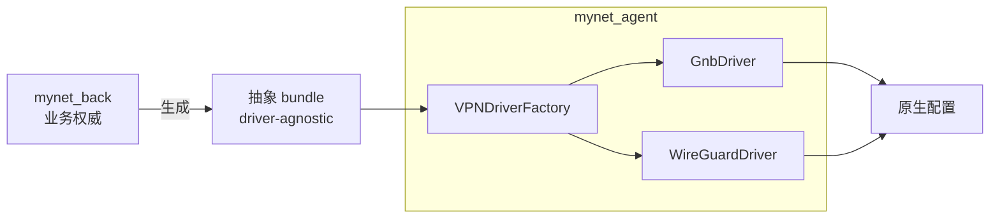

# SPEC: VPN Driver 抽象层（driver-abstraction）

> 更新：2026-09-21 | 适用：`mynet_agent`（实现）、`mynet_back`（配置生成）
> 来源规划：`integration-plan-v2.md` §3 W2
> 状态：**设计稿**（P0 交付；P1 落接口壳）

---

## 1. 目的

让「数据面驱动」可替换：把 gnb 特有物收敛到驱动边界，使未来切换到 wireguard 的成本 =
**写一个 driver + 注册**，而不是满仓改。

同时把配置的**抽象**（想连谁、走哪些网段）与**具体格式**（gnb 的 `node.conf` / wg 的 `wg set`）拆开。

---

## 2. 现状

### 2.1 已有的接缝 ✅

`mynet_agent/internal/domain/vpn_driver.go` 已定义：

```
VPNDriverType  = "gnb" | "wireguard"
VPNDriver      = { GetDriverType, IsAvailable, IsProcessAlive,
                   GetAllPeers, GetOnlinePeers, GetPeer, GetLocalPeer,
                   GetNetworkSummary, Refresh }
VPNDriverFactory = { CreateDriver, DetectDriver }
```

**接缝存在，但只覆盖「读」**（peers/status）。配置写入、生命周期、格式转换仍在接缝之外。

### 2.2 仍硬绑 gnb 的四处 ❌

| # | 泄漏点 | 位置 | 症状 |
|---|--------|------|------|
| **L1** | 配置包生成 gnb 原生格式 | `back` config-bundle → `files["node.conf"/"address.conf"/"route.conf"]` | back 必须知道 gnb 文件格式 |
| **L2** | 热重启机制 | `agent`：`gnb_ctl -b gnb.map -w core.flag=2`，回落 SIGHUP，再冷启 | 重载逻辑写死 gnb 工具链 |
| **L3** | 分发产品名 | `ctl` manifest 的 `gnb` 条目、`conventions.md` 产品表 | 无 wireguard 产品位 |
| **L4** | 格式定义 | `spec/data-models.md` §4/§9 | 抽象与 gnb 原生混写在一节 |

---

## 3. 设计：两层



- **抽象层**：`VPNBundle` —— back 只产出它，不含任何 gnb/wg 语法。
- **适配层**：每个 driver 把 `VPNBundle` 翻译成原生配置并管理生命周期。

### 3.1 抽象 bundle（driver-agnostic）

back 的 `config-bundle` 收敛为**与驱动无关**的结构：

```json
{
  "driver": "gnb",
  "node": {
    "id": "3722810996882027",
    "interface": "gnb_tun_178",
    "listen_port": 9016,
    "mtu": 1450
  },
  "peers": [
    {
      "id": "8283289760467957",
      "public_key": "a49e4acf...",
      "endpoint": null,
      "allowed_ips": ["10.182.236.0/24", "192.168.0.0/24"]
    }
  ],
  "routes": [
    { "node_id": "3722810996882027", "network": "10.182.236.0", "netmask": "255.255.255.0" }
  ],
  "keys": {
    "self": { "private": "48973280...", "public": "e9ca457c..." },
    "peers": { "8283289760467957": "a49e4acf..." }
  },
  "flags": { "proxy": "off" },
  "discovery": { "index_servers": ["52.221.22.241:9016", "idx.mynet.club:9016"] }
}
```

> **注意 `discovery` 字段**：gnb 的 P2P 索引发现**没有** wireguard 的 1:1 等价物。
> 抽象层保留该字段（可选），但**不得假设所有驱动都支持** —— driver 能力用 §3.2 的 `Capabilities()` 声明。

### 3.2 扩展后的驱动接口

在现有 `VPNDriver`（读）基础上补**写与生命周期**：

```
VPNDriver  (现有读方法保持)
  + Capabilities() DriverCaps        // 声明是否支持 hot_reload / discovery / proxy
  + WriteConfig(b *VPNBundle) error  // 抽象 bundle → 原生配置（磁盘）
  + Start() error
  + Stop() error
  + Reload() error                   // 优先热重启，回落冷启
  + Status() (*DriverStatus, error)  // 进程/tun/版本
```

**每个泄漏点的归位**：

| 泄漏点 | 归位到 |
|--------|--------|
| L1 配置格式 | `driver.WriteConfig(bundle)`（back 只产抽象 bundle） |
| L2 热重启 | `driver.Reload()`（gnb 实现内含 `gnb_ctl`） |
| L3 产品名 | `conventions.md` 产品表补 `wireguard`；ctl manifest 按产品分发 |
| L4 格式定义 | 本文件（抽象层） + `data-models.md` 只留「gnb adapter」节 |

### 3.3 概念映射表（gnb ↔ wireguard）

| 抽象概念 | gnb 实现 | wireguard 实现 |
|----------|----------|----------------|
| `node.id` | 16 位 `nodeid` | 公钥指纹（base64→id） |
| `node.listen_port` | `node.conf: listen` | `[Interface] ListenPort` |
| `node.interface` | `node.conf: ifname`（`gnb_tun_*`） | `wg0` 等设备名 |
| `node.mtu` | `node.conf: mtu` | `[Interface] MTU` |
| `keys.self.private` | `security/{id}.private`（128 hex） | `[Interface] PrivateKey` |
| `keys.peers[id]` | `ed25519/{id}.public`（64 hex） | `[Peer] PublicKey` |
| `routes[]` | `route.conf`：`{node_id}\|{net}\|{mask}` | `[Peer] AllowedIPs` |
| `discovery.index_servers` | `address.conf`：`i\|0\|ip\|port` | ⚠️ **无等价**（需 Endpoint/中继） |
| `flags.proxy` | `node.conf: proxy on` | ⚠️ 无等价（走路由策略层） |
| 热重启 | `gnb_ctl -w core.flag=2` | `wg syncconf <if> <(wg-quick strip ...)` |
| 运行时对端表 | `gnb.map` | `wg show <if> dump` |

> **两个 ⚠️ 是真正的语义缺口**：gnb 是 P2P + 索引发现 + 内建 proxy 标志；
> wireguard 是显式 Endpoint 的点对点。抽象层必须让这些成为**驱动能力差异**，而非假设。

---

## 4. 现状落差（2026-09-21 对 mynet_agent 实测）⚠️

本节写于侦察**之后**。上文 §1-§3 的部分假设与代码实际不符，落地前必须知道：

| # | 原假设 | 实测 | 影响 |
|---|--------|------|------|
| **D1** | 热重启已存在（`gnb_ctl -b gnb.map -w core.flag=2`） | **代码里根本不存在**。全仓（含非 Go）搜不到 `gnb_ctl -w` / `core.flag`。仅 `cmd/mynetd/main.go:152,174` 的 SIGHUP 用于重载 **daemon 自身 config**，与 gnb 无关 | `Reload()` 无现成实现可搬；首版只能冷重启，热重启需单独立项并**先验证目标 gnb 版本支持** |
| **D2** | 只有一个 driver 待扩展 | `GNBDriver` 仅**只读**（`internal/infrastructure/gnb_driver.go`，走 `gnb_ctl -s -b gnb.map`）；工厂对 wireguard 直接返回 `"TODO v0.10.0"`（`vpn_driver_factory.go:26-31`）；`driver/wireguard/` 是**空目录** | `WriteConfig/Start/Stop` **无承接者**，需从零散代码收敛 |
| **D3** | VPN 类型抽象单一 | **三套常量并存**：`domain.VPNDriverType` / `node.VPNTypeWireGuard` / `common.NodeTypeWireGuard`（另有 `config.WG`） | 不先统一，driver 分派必然漂移 |
| **D4** | conf 路径集中、生命周期单点 | `driver/gnb/conf/{nodeID}` 硬编码散落 **~10 个文件**；gnb 生命周期有**三条并存**：`GNBRunner`(PID 文件) / `Manager`(内存 PID) / 系统服务(systemd·launchd·procd) | `Start/Stop` 统一需先指定唯一权威，否则行为分叉 |

> 另有落盘敏感点：`security/*.private` 为 0600，搬迁**不得改变文件模式**。

---

## 5. 落地步骤（修订）

**原则：先立接口、划边界（行为零变化），再逐步收敛。不要一步到位。**

| 步 | 动作 | 出口判据 |
|----|------|----------|
| **S1** | 只加接口与类型：`Capabilities()/WriteConfig()/Start()/Stop()/Reload()/Status()` + `DriverCaps` + `VPNBundle`，**不做实现搬迁** | 编译通过，行为零变化 |
| **S2** | 统一 VPN 类型常量（D3）→ 单一来源，旧常量标 `deprecated` | 三套收敛为一 |
| **S3** | 把现有 gnb 行为**逐项**搬进 `GnbDriver`：只读（已在）→ `WriteConfig` → `Start/Stop` → `Reload`(冷启) | 每搬一项可独立验证行为不变 |
| **S4** | 指定 gnb 生命周期的**唯一权威**（D4），其余两条改为委托 | 全系统只有一处启动 gnb |
| **S5** | `Reload()` 热重启（D1）：**先验证**目标 gnb 版本是否支持 `gnb_ctl -w core.flag=2`；不支持则维持冷启 | 有验证记录 + 回落路径 |
| **S6** | back 改产抽象 bundle（见 `back-upshift-design.md` §5）；ctl 注册 `wireguard` 产品位 | 契约与产品位就位 |
| **S7** | `WireGuardDriver` 实现（D2），能力差异用 `Capabilities()` 声明 | 缺项优雅降级 |

**风险**：S3/S4 触碰 gnb 生命周期，是高风险区——动手前需建立可验证的行为基线（或至少人工核对清单）。

---

## 6. 非目标

- 不做通用插件框架 / 动态加载 `.so`
- 不改 gnb 源码（不变量 I1）
- 不在本阶段真正启用 wireguard（只预留接口与产品位）
- 抽象层不承诺「所有驱动功能对齐」——能力差异由 `Capabilities()` 显式暴露
