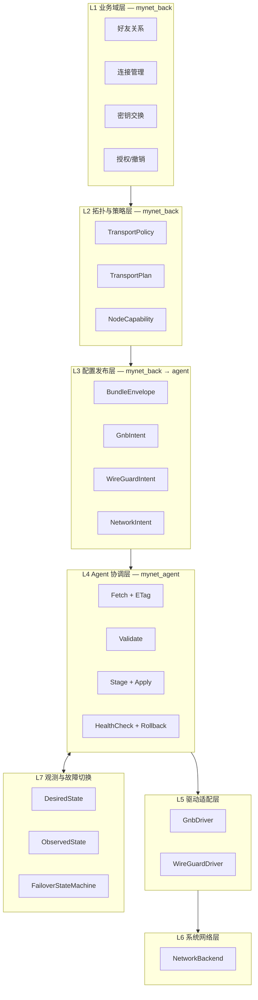
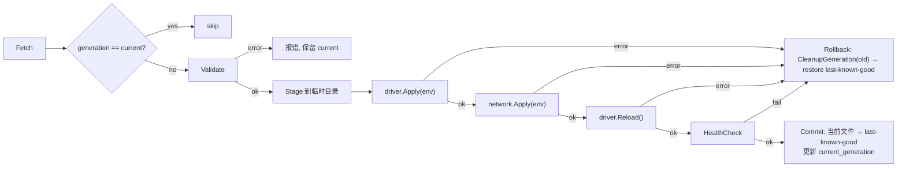
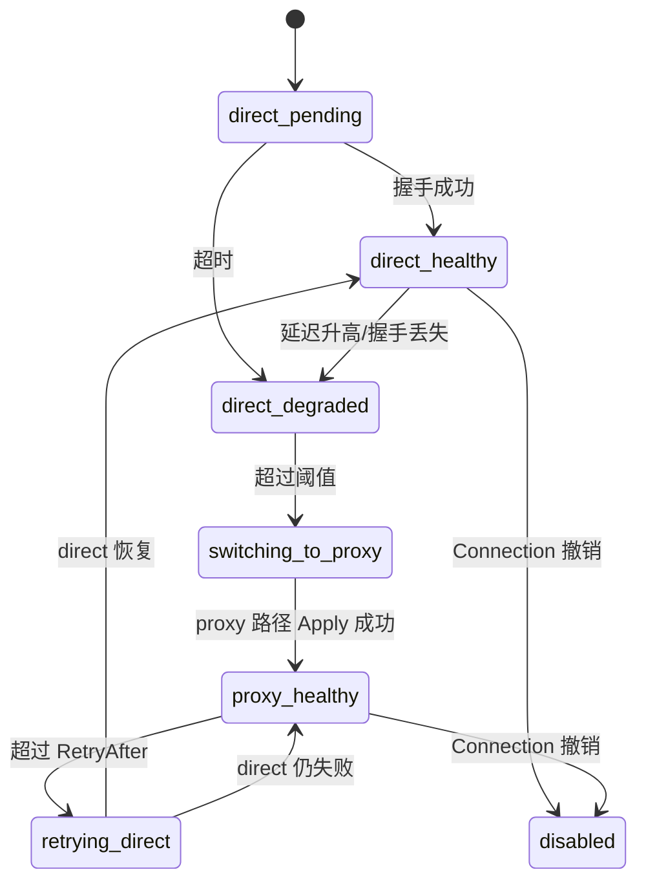

# SPEC: 统一平台架构与实施计划

> 更新：2026-09-21 | 适用：`mynet_back`（业务权威）、`mynet_agent`（节点执行）、`mynet_ctl`（安装分发）
> 状态：**设计稿**（已完成机制调研与草案撤回；本文档为正式设计）
> 依赖：`driver-abstraction.md`（底层驱动差异分析）、`back-upshift-design.md`（业务上移边界）
>
> **核心原则**：上层业务逻辑（好友、连接、密钥、授权）在 GNB 和 WireGuard 之间完全统一。
> 驱动差异从「驱动编排层」开始向下分化，不泄漏到业务对象。

---

## 0. 分层总览



### 0.1 传输与控制面（横切，不改变业务分层）

L1~L7 是**业务与驱动**分层；节点与 back 之间**怎么连**由
[`control-plane.md`](control-plane.md) 单独定义：

```
mynetd ══WebSocket══> mynet-gateway ──内网 HTTP──> mynet_back
                              ↑
                    节点面唯一入口；back 对节点不可达
```

| 约束 | 说明 |
|------|------|
| back 仍是唯一业务权威 | gateway 只做鉴权 / 连接 / presence / **字节中继**，不解析业务载荷 |
| L3/L4 语义不变 | `Fetch(nodeID, etag)` 仍成立，只是经 gateway 中继；ETag / checksum / last-known-good 回滚原样保留 |
| `mynet_gnb` 不被触碰 | gateway 对的是 `mynetd`，不是 gnb 进程 |
| GUI 只谈本机 | `浏览器 → 127.0.0.1:mynetd httpd → gateway → back`，见 [`local-api.md`](local-api.md) §0 |

多 gateway 就近接入、以及「公网被封时借 node 的 overlay 访问 gateway」的韧性设计，见 `control-plane.md` §3–§4。

---

## 1. L1 业务域层

**归属**：`mynet_back`
**职责**：好友关系、连接生命周期、密钥管理、授权/撤销——完全不含驱动术语。

### 1.0 身份模型：admin / operator[tenant] / user 三重层 ⚠️

框架把**访问面**分成三层，身份类型只有两个（`User` / `Operator`），但**只有 Operator 有角色与 RBAC**：

| 层 | 语义 | 身份 | 角色 / 权限 | 域 `domain_type` | 典型门禁 |
|---|---|---|---|---|---|
| **① admin** | **平台** | `Operator` 且 `scope='platform'` | RBAC 平台权限（`platform.*`） | `admin` | `tenant.permission`、`rbac.permission:platform.*` |
| **② operator[tenant]** | 租户运营 | `Operator`，经 `operator_tenants.role_id` 绑定 | **有 role** → RBAC 租户权限 | `console` | `tenant.permission`（仅 `tenant_admin` 角色可进） |
| **③ user** | **用户消费层** | `User`，经 `tenant_users` 关联 | **没有角色、没有权限概念** | `api` / `app` | `auth:sanctum`、`tenant.ensure` |

依据（框架源码，非推断）：
- `CheckPermission` docblock：「平台 admin 后台仅 `scope=platform` 的 Operator 可访问；
  团队 console 后台仅 tenant_admin 角色 Operator 可访问；
  团队前台 /app 由 **User（经 tenant_users 关联，不拥有角色）** 或 Operator（经 operator_tenants）访问」
- `RbacService` docblock：「角色仅属于 Operator，经 `operator_tenants.role_id` 关联，RBAC 只作用于 Operator；
  **User 不拥有角色（tenant_users 无 role_id 字段），永远无 RBAC 权限**」——`check()` 对非 Operator 直接 `return false`
- `checkConsoleAccess()`：User 走 console 一律 `tenant_admin_only` 403
- 平台 admin 路由落在框架 `platform`/`operator` 模块的 `Routes/admin.php`（挂 `rbac.permission:platform.*`），
  由 `adm.mynet.club` 那个 SPA 承接——**不在 back**

**back 的实现全部在 ③ user 层**：节点/连接/密钥/好友挂在 `users.user_id`，全仓不引用 `Operator`。
user 层**本就没有 role 与 permission 概念**，因此 back 不需要 RBAC，也不该出现
「带 role 的 User 管理员」——admin 是平台层（Operator），不是 User。

> **硬规则（用户明确）**：**一套代码里三重角色都在**，但
> **所有角色与权限一律由框架实现**；back 侧任何与之冲突的自建实现**直接删掉**。
> 业务域里名字叫 `role` 的字段（如 `participants.role`、`agents.role`、消息 `role`）
> 不是鉴权角色，不受此规则约束。

> **第二条硬规则（用户明确）**：**用户注册、邮箱激活、密码重置等身份生命周期
> 一律交给框架**；back **只关心业务**。框架 auth 模块已提供完整面
> （`api/v1/auth/{login,register,forgot-password,reset-password,verify-email,
> resend-verification,me,logout,password,profile}` + MFA/SSO/SMS/联系人绑定），
> back 不得再自建一份。

> **第三条（用户明确）**：**先不碰平台与租户，只把消费者层跑通**。
> admin/operator[tenant] 那些是后事。

已实测确认边界成立：`tenant.permission` 门禁挂载的路由**全部属 vendor 模块**，
back 自有 **0 条**。`bootstrap/app.php` 中 `tenant.permission` / `rbac.permission` / `mcp.auth`
三个别名是为**框架 vendor 模块**注册的，必须保留，**但不得挂到 back 自有路由上**。

> 对本设计的影响：L2～L7 的一切「授权」都基于 `Connection`/`ConnectionGrant` 业务授权，
> **不依赖**框架的 Operator/RBAC 门禁。不要因为 scrm-platform 在其模块路由上使用
> `VerifyOperatorTenant` 就照搬——scrm 是面向运营的平台，back 不是。

> **层错位警示**：back 曾有的 `routes/admin.php` + `AdminMiddleware` + `users.role`
> 是在 user 层里凭空造了一个「admin」，框架模型中没有这一层。平台后台属于
> ①admin（框架 platform/operator 模块 + `adm.mynet.club` SPA），不属于 back。
> RBAC 三表（`permissions`/`roles`/`role_permissions`）同理——那是 ②operator[tenant] 的资产。

### 1.1 核心对象

```
NodeIdentity
  node_id       int       业务主键（驱动无关）
  tenant_id     int
  user_id       int
  vpn_type      string    当前节点选用的驱动类型："gnb"|"wireguard"
  node_status   int       业务状态（-1/0/1/2/99）

Friendship
  source_user_id   int    发起方
  target_user_id   int    接受方
  status           string "pending"|"accepted"|"rejected"|"revoked"
  created_at       datetime
  updated_at       datetime

ConnectionRequest
  connection_id    int    唯一标识
  source_node_id   int    发起节点
  target_node_id   int    目标节点
  status           string "pending"|"approved"|"rejected"|"revoked"
  reason           string|null

Connection        // ConnectionRequest 批准后的持久化实体
  connection_id    int
  source_node_id   int
  target_node_id   int
  tenant_id        int
  status           string "active"|"suspended"|"revoked"
  created_at       datetime

ConnectionGrant   // 授权：允许访问的资源/网段
  grant_id         int
  connection_id    int
  resource_type    string "network"|"node"|"service"
  resource_ref     string CIDR / node_id / service_id
  permission       string "read"|"write"|"full"
  status           string "active"|"revoked"

KeyExchange       // 公钥登记与轮换
  key_id           int
  node_id          int
  algorithm        string "ed25519"|"curve25519"   // 由 vpn_type 决定
  public_key       string    Base64/hex（取决于算法）
  key_version      int       轮换序号
  status           string "active"|"rotated"|"revoked"
  created_at       datetime
```

### 1.2 业务命令接口（PHP 侧，Domain Service）

```php
namespace App\Modules\VPN\Domain\Services;

interface ConnectionDomainService
{
    /** 好友发送连接请求 */
    public function requestConnection(
        int $sourceNodeId,
        int $targetNodeId,
        ?string $reason = null,
    ): ConnectionRequest;

    /** 好友批准连接 → 创建 Connection + 默认 Grant */
    public function approveConnection(
        int $connectionId,
        int $approverUserId,
    ): Connection;

    /** 撤销连接（同时撤销所有 Grant） */
    public function revokeConnection(int $connectionId, int $revokerUserId): void;

    /** 更新授权：添加/删除可访问网段 */
    public function updateGrant(
        int $connectionId,
        string $resourceType,
        string $resourceRef,
        string $permission,
    ): ConnectionGrant;

    /** 撤销单条授权 */
    public function revokeGrant(int $grantId, int $revokerUserId): void;
}

interface KeyExchangeDomainService
{
    /** 节点注册/更新公钥（由节点首次上线时调用） */
    public function registerPublicKey(
        int $nodeId,
        string $algorithm,
        string $publicKey,
    ): KeyExchange;

    /** 轮换公钥（业务层标记旧 key 为 rotated，新 key 为 active） */
    public function rotateKey(int $nodeId): KeyExchange;

    /** 撤销公钥（节点下线或安全事件） */
    public function revokeKey(int $nodeId, int $keyId): void;

    /** 获取两个节点之间的双向公钥对（供配置生成使用） */
    public function getPeerKeyPair(int $nodeIdA, int $nodeIdB): ?array;
}
```

### 1.3 状态机

```
ConnectionRequest:  pending → approved | rejected
                         ↑
Friendship:         pending → accepted → (ConnectionRequest 可创建)

Connection:         active → suspended → active
                         ↘ revoked (终态)

KeyExchange:        active → rotated (终态)
                         ↘ revoked (终态)

ConnectionGrant:    active → revoked (终态)
```

### 1.4 与现有模型的映射

| 新对象 | 现有 back 模型 | 现有 agent 行为 |
|--------|---------------|----------------|
| `NodeIdentity` | `nodes` 表 | — |
| `Friendship` | `friendships`/`friend_requests` 表（仅有 migration，无 Eloquent 模型，由 SocialController 直接操作） | — |
| `ConnectionRequest` | `routes` 表（`status=pending`） | — |
| `Connection` | `routes` 表（`status=enabled`） | `route.refresh` 触发 |
| `ConnectionGrant` | 无独立模型（隐含在 `node_ips`） | `route.conf` 中的网段 |
| `KeyExchange` | `node_keys` 表 | `ed25519/` 或 WG peer |

**当前缺失**：
- `ConnectionGrant`：无独立表
- `KeyExchange.algorithm`/`key_version`/`status`：`node_keys` 表不存在这些列
- `Connection.status` 的 `suspended`/`revoked`：`routes.status` 仅 0/1/2/3（disabled/enabled/pending/rejected），需扩展或映射
- `ConnectionRequest` 与 `Connection` 共用 `routes` 单表：过渡期通过 status 区分，后续可拆分

**Status 映射**（routes.status → 新模型）：

| routes.status | 含义 | ConnectionRequest.status | Connection.status |
|---------------|------|-------------------------|-------------------|
| 0 (DISABLED)  | 禁用 | — | suspended |
| 1 (ENABLED)   | 启用 | — | active |
| 2 (PENDING)   | 待审批 | pending | — |
| 3 (REJECTED)  | 拒绝 | rejected | — |
| (新增 4)      | 撤销 | revoked | revoked |

**与现有 agent 代码的关系**：
- 现有 `internal/domain/vpn_driver.go` 的 `VPNDriver`（只读接口）保持不变
- 现有 `internal/domain/vpn_bundle.go` 的 `VPNBundle` 将被 `BundleEnvelope` 取代（阶段 2-3）
- 现有 `internal/domain/vpn_driver_factory.go` 的工厂模式保持，但创建的 driver 实现 `ConfigDriver` 而非仅 `VPNDriver`
- `internal/tools/firewall|routing` 中的多写者将在阶段 7.5 收敛到 NetworkBackend

### 1.5 出口判据

- [ ] 同一套业务命令（request/approve/revoke/rotate/grant）在 GNB 和 WG 测试场景下均通过
- [ ] 业务对象不包含任何 `node.conf`/`AllowedIPs`/`endpoint`/`gnb`/`wireguard` 字段
- [ ] PHP Domain Service 的接口签名已冻结，可作为 API 契约基准

---

## 2. L2 拓扑与策略层

**归属**：`mynet_back`
**职责**：将业务 Connection 翻译成「怎样通信」——仍不生成驱动配置。

### 2.1 核心对象

```
TransportPolicy     // 存储在 Connection 上的策略配置
  mode              string  "direct"|"proxy"|"relay"|"auto"|"disabled"
  allow_direct      bool
  fallback_to_proxy bool
  proxy_node_id     int|null   指定的代理节点（mode=proxy/auto 时使用）
  relay_node_ids    array      指定的中继链（mode=relay 时使用）
  keepalive_seconds int|null   WG 侧 PersistentKeepalive（GNB 忽略）

NodeCapability      // 从 NodeIdentity + 运行状态推导
  node_id           int
  vpn_type          string
  can_accept_inbound bool    是否可达
  has_public_endpoint bool   是否有公网地址
  can_proxy         bool     是否可作代理节点（GNB f 节点 / WG hub）
  can_relay         bool     是否可作中继节点
  supports_ipv6     bool
  region            string|null
```

### 2.2 策略引擎接口

```
TransportPlanner  // 纯函数，输入业务连接 + 能力表 → 输出拓扑计划

  input:
    connection    Connection
    grants        ConnectionGrant[]
    source_node   NodeIdentity + NodeCapability
    target_node   NodeIdentity + NodeCapability
    proxy_node    NodeIdentity + NodeCapability | null

  output: TransportPlan
```

```
TransportPlan
  connection_id     int
  mode              string
  active_path       DirectPlan | ProxyPlan | RelayPlan | null   // null 当 mode=disabled
  fallback_path     ProxyPlan | RelayPlan | null
  driver_hints      array   // 供 L5 使用的业务提示（不含原生语法）
```

> **类型约定**：`node_id` 在业务模型中为 `int`，在 BundleEnvelope/JSON 中统一为 `string`
> （跨语言兼容，避免 PHP int 与 Go int64 精度差异）。

> **`driver_hints` 槽位**：Envelope 的 `connections[]` 中每个连接条目包含
> `active_path`/`fallback_path`，`driver_hints` 的内容由 L5 Driver 在 Apply 时
> 根据 TransportPlan 自行推导，不需要在 Envelope 中单独传输。

```
DirectPlan
  source_node_id    int
  target_node_id    int
  target_endpoint   string|null   // 业务侧已知的 endpoint（可能为空）
  target_prefixes   string[]      // 允许访问的网段（来自 Grant）

ProxyPlan
  proxy_node_id     int
  source_node_id    int
  target_node_id    int
  source_prefixes   string[]
  target_prefixes   string[]

RelayPlan
  relay_node_ids    int[]         // 有序中继链
  source_node_id    int
  target_node_id    int
  target_prefixes   string[]
```

### 2.3 策略引擎接口（PHP Domain Service）

```php
namespace App\Modules\VPN\Domain\Services;

interface TransportPlannerDomainService
{
    /**
     * 为一个 Connection 计算传输计划。
     * @param Connection $connection     业务连接
     * @param ConnectionGrant[] $grants  该连接的所有授权
     * @param NodeCapability $sourceCap  发起节点的能力
     * @param NodeCapability $targetCap  目标节点的能力
     * @param NodeCapability|null $proxyCap  指定代理节点的能力（mode=proxy/auto 时必传）
     */
    public function plan(
        Connection $connection,
        array $grants,
        NodeCapability $sourceCap,
        NodeCapability $targetCap,
        ?NodeCapability $proxyCap = null,
    ): TransportPlan;

    /**
     * 为一个节点的所有 Connections 批量计算。
     * @param NodeCapability $selfCap  本节点能力
     * @param array<NodeCapability> $peerCaps  所有对端节点能力（keyed by node_id）
     * @param array<NodeCapability> $proxyCaps 所有候选代理节点能力（keyed by node_id）
     */
    public function planAll(
        int $nodeId,
        array $connections,
        array $grants,
        NodeCapability $selfCap,
        array $peerCaps,
        array $proxyCaps,
    ): array;  // TransportPlan[]
}
```

**NodeCapability 推导数据源**（back 侧）：

| 字段 | 来源 |
|------|------|
| `can_accept_inbound` | `nodes.node_status` 在 [1,2] 且最近心跳 < 阈值 |
| `has_public_endpoint` | `node_ips` 中存在 `ip_type=wan_ip` 或 `endpoint_ip` |
| `can_proxy` | `nodes.node_type` 包含 PROXY/GATEWAY 位（位掩码 4/64） |
| `can_relay` | `nodes.node_type` 包含 RELAY/MASTER 位（位掩码 2/8） |
| `supports_ipv6` | `node_ips` 中存在 IPv6 地址 |
| `region` | `nodes.node_remarks` 或独立 region 字段（待定） |

### 2.4 `auto` 模式的业务语义

```
业务层声明: mode = "auto", allow_direct = true, fallback_to_proxy = true

策略引擎输出:
  active_path  = DirectPlan(...)      // 优先尝试直连
  fallback_path = ProxyPlan(...)      // 直连失败后切换

驱动解释:
  GNB: 生成 route.conf 同时包含 direct + forward/proxy 配置
       GNB 协议层自行选择 P2P 或 forward
  WG:  不含自动 fallback——L7 观测层负责检测并切换 peer 配置
```

### 2.5 出口判据

- [ ] 给定相同 `Connection + Grants + NodeCapability`，策略引擎在 GNB 和 WG 场景下输出相同结构的 `TransportPlan`（仅 driver_hints 不同）
- [ ] `auto` 模式同时包含 `active_path` 和 `fallback_path`
- [ ] `TransportPlan` 不含任何 GNB/WG 原生语法
- [ ] 策略引擎的输入输出均有单元测试覆盖

---

## 3. L3 配置发布层

**归属**：`mynet_back` → `mynet_agent`
**职责**：将 TransportPlan 序列化为 BundleEnvelope，管理版本与发布。

### 3.1 BundleEnvelope Schema

```json
{
  "schema_version": 2,
  "generation": "rev-20260921-001",
  "checksum": "sha256:...",
  "generated_at": "2026-09-21T12:00:00Z",
  "min_agent_version": "0.9.0",
  "node_id": "1001",
  "driver": "gnb",
  "connections": [
    {
      "connection_id": 123,
      "target_node_id": "1002",
      "transport_mode": "auto",
      "transport_policy": {
        "allow_direct": true,
        "fallback_to_proxy": true,
        "proxy_node_id": "9001",
        "keepalive_seconds": 25
      },
      "active_path": { "...": "DirectPlan" },
      "fallback_path": { "...": "ProxyPlan" }
    }
  ],
  "network": {
    "addresses": ["10.20.0.1/24"],
    "routes": [
      { "prefix": "192.168.20.0/24", "via_node_id": "1002", "type": "unicast" }
    ],
    "rules": [],
    "firewall": [],
    "nat": []
  },
  "gnb": null,
  "wireguard": null,
  "capabilities": {
    "driver_caps": { "...": "运行时探测结果" },
    "agent_version": "0.9.0",
    "platform": "linux"
  }
}
```

### 3.2 GnbIntent（driver=gnb 时填充）

```json
{
  "gnb": {
    "identity": {
      "node_id": "1001",
      "private_key_ref": "secret://node_keys/1001/private",
      "public_key": "64-hex"
    },
    "listeners": ["0.0.0.0:9016"],
    "peers": [
      {
        "node_id": "1002",
        "public_key": "64-hex",
        "tun_ip": "10.20.0.2",
        "tun_netmask": "255.255.255.0"
      }
    ],
    "routes": [
      { "node_id": "1002", "network": "192.168.20.0", "netmask": "255.255.255.0" }
    ],
    "discovery": {
      "index_servers": ["52.221.22.241:9016"]
    },
    "forwarding": {
      "direct": true,
      "standard": true,
      "unified": "auto",
      "proxy": false,
      "relay_routes": []
    },
    "options": {
      "multi_socket": true,
      "safe_index": true,
      "mtu": 1450,
      "ifname": "gnb_tun_1001"
    }
  }
}
```

### 3.3 WireGuardIntent（driver=wireguard 时填充）

```json
{
  "wireguard": {
    "interface": {
      "private_key_ref": "secret://node_keys/1001/private",
      "public_key": "base64-32-byte",
      "addresses": ["10.20.0.1/24"],
      "listen_port": 51820,
      "fwmark": null,
      "mtu": 1420,
      "dns": []
    },
    "peers": [
      {
        "id": "conn-1002",
        "business_node_id": "1002",
        "public_key": "base64-32-byte",
        "preshared_key_ref": null,
        "bootstrap_endpoint": "203.0.113.2:51820",
        "allowed_ips": ["10.20.0.2/32", "192.168.20.0/24"],
        "persistent_keepalive_seconds": 25
      }
    ],
    "routing": {
      "mode": "managed",
      "table": "auto"
    }
  }
}
```

### 3.4 发布模型

```
配置生命周期:
  draft → validated → published → applying → active
                              ↘ failed → rollback

生成时机:
  - Connection approve/revoke
  - Grant update
  - KeyExchange rotate/revoke
  - TransportPolicy change
  - Manual admin trigger

存储:
  back: config_revisions 表（schema_version, generation, envelope JSON, checksum）
  agent: /var/lib/mynet/bundle/{generation}.json + last-known-good.json
```

### 3.5 秘密引用解析

`secret://` URI 是 Envelope 中私钥/PSK 的引用格式，不包含明文。

```
格式: secret://{source}/{id}/{field}

已知 source:
  node_keys    back 的 node_keys 表
    示例: secret://node_keys/1001/private
    解析: back 在生成 Envelope 时将明文写入 Envelope 的内联字段

解析时机:
  back 生成 Envelope 时：
    1. 读取 secret:// 引用
    2. 从对应数据源获取明文
    3. 将明文写入 Envelope 的 driver-specific intent 字段
       GNB: gnb.identity.private_key
       WG:  wireguard.interface.private_key
       WG:  wireguard.peers[].preshared_key
    4. Envelope 中仅保留明文字段，secret:// 引用不下发给 agent

agent 侧:
  agent 收到的 Envelope 已包含明文私钥（在 driver-specific intent 中）
  agent 不需要解析 secret:// — 该引用仅存在于 back 内部生成流程

迁移路径:
  当前 vpn_bundle.go 的 BundleKeys.Self.Private 是明文字段
  阶段 2 实现 BundleEnvelope 生成器时：
    - Envelope 的 driver intent 中保留明文 private_key（与当前行为一致）
    - secret:// 引用仅用于 back 内部生成流程的可追溯性
    - 后续阶段可将 agent 侧改为 secret_ref 模式（agent 自行从安全存储读取）
```

| 场景 | 处理 |
|------|------|
| agent 版本 < min_agent_version | 不下发，agent 继续使用 last-known-good |
| envelope schema_version > agent 支持的版本 | agent 忽略新字段，按自身 schema_version 解释 |
| driver 与 envelope.gnb/wireguard 不匹配 | agent 报错并拒绝 Apply |
| checksum 校验失败 | agent 报错并拒绝 Apply |

### 3.6 出口判据

- [x] JSON Schema 已定义并可校验
  - SSOT: `spec/schemas/bundle-envelope-v2.schema.json`（draft 2020-12）
  - 双端 typed 解码 + fixture 覆盖即结构校验；完整 JSON Schema 库未接入（非 R2 阻塞项）
- [x] PHP 和 Go 使用同一组 fixtures，双端解码结果一致
  - fixtures: `spec/fixtures/bundle-envelope-v2/`（7 个场景：gnb-minimal / gnb-peers-routes / gnb-proxy-relay / gnb-ipv6 / wireguard-minimal / wireguard-multi-peer / compat-extra-fields）
  - Go: `mynet_agent/internal/domain/bundle_envelope.go` + 测试
  - PHP: `mynet_back/app/Modules/VPN/Domain/Bundle/` + `tests/BundleEnvelopeV2Test.php`
  - 两边 checksum 与 fixtures 预计算值一致（canonical JSON 算法已冻结，见 schema `$defs.checksumAlgorithm`）
- [ ] `generation` 单调递增，支持 ETag/304
  - 字段已定义；单调性与 ETag 由 back 发布链保证（阶段 2.6 / R8）
- [x] `checksum` 校验流程有测试覆盖
  - Go `TestBundleEnvelopeFixturesChecksumRoundTrip` / PHP `testComputeChecksumMatchesFixture`
- [ ] 兼容策略的四个场景均有测试覆盖
  - 已覆盖：agent 版本过旧（`min_agent_version` 字段 + 注释约定）、未知字段忽略（compat-extra-fields）、driver 与 intent 错配（schema allOf + 测试）、checksum 失败（verify 用例）
  - 「不下发 / 拒绝 Apply」的运行时策略属 R4 BundleValidator

---

## 4. L4 Agent 协调层

**归属**：`mynet_agent`
**职责**：拉取 BundleEnvelope → 校验 → 原子 Apply → 健康检查 → Commit/Rollback。

### 4.1 核心接口（Go）

```go
package coordinator

// BundleFetcher 从 back 拉取 BundleEnvelope
type BundleFetcher interface {
    // Fetch 使用 ETag 做条件请求
    Fetch(nodeID string, etag string) (*BundleEnvelope, string /* newETag */, error)
    // FetchFull 无条件拉取（首次或强制刷新时使用）
    FetchFull(nodeID string) (*BundleEnvelope, string, error)
}

// BundleValidator 校验 BundleEnvelope
type BundleValidator interface {
    // Validate 检查 schema、checksum、driver 匹配、capabilities
    Validate(env *BundleEnvelope, localCaps LocalCapabilities) error
}

// BundleApplier 原子 Apply
type BundleApplier interface {
    // Apply 执行完整流程：stage → driver.Apply → network.Apply → reload → healthcheck
    // 任一步失败自动 rollback，返回错误
    Apply(env *BundleEnvelope) (*ApplyResult, error)
    // Rollback 恢复到 last-known-good
    Rollback() error
    // CurrentGeneration 返回当前生效的 generation
    CurrentGeneration() string
}

// ApplyResult Apply 结果
type ApplyResult struct {
    Generation     string
    DriverApplied  bool
    NetworkApplied bool
    Reloaded       bool
    Healthy        bool
    Duration       time.Duration
    Warnings       []string
}
```

### 4.2 Apply 流程



### 4.3 缓存与离线

```
/var/lib/mynet/bundle/
  {generation}.json      // 每个 generation 的副本
  last-known-good.json   // 最近一次健康 Apply 的副本
  current_generation     // 文本文件，记录当前生效的 generation
  apply_journal.jsonl    // 每次 Apply 的日志
```

离线策略：
- agent 启动时优先使用 `last-known-good.json`
- Fetch 失败时使用 last-known-good，不阻塞启动
- 旧 `node.refresh` / `route.refresh` 入口委托给 `BundleApplier.Apply`

### 4.4 写入权收敛

| 文件 | 当前写入者 | 目标写入者 |
|------|-----------|-----------|
| node.conf | node.refresh / GNBRunner / GNBDriver.WriteConfig | 仅 GNBDriver.Apply |
| route.conf | route.refresh / GNBDriver.WriteConfig | 仅 GNBDriver.Apply |
| address.conf | 安装包 | 仅 GNBDriver.Apply |
| ed25519/ | route.refresh / GNBDriver.WriteConfig | 仅 GNBDriver.Apply |
| security/ | credential init / GNBDriver.WriteConfig | 仅 GNBDriver.Apply |
| WG interface | mynet.wg.refresh.address | 仅 WireGuardDriver.Apply |
| OS routes | CLI route tools | 仅 NetworkBackend.Apply |

**过渡策略**：旧 refresh 方法改为调用 `BundleApplier.Apply(fetchResult)`，不再直接写文件。

### 4.5 出口判据

- [ ] `BundleApplier.Apply` 有完整的 stage/rollback 测试（注入 write/reload/healthcheck 失败）
- [ ] 旧 `node.refresh` / `route.refresh` 入口委托给 Apply 后行为不变
- [ ] 断网时 agent 能使用 last-known-good 启动
- [ ] `apply_journal.jsonl` 记录每次 Apply 的完整生命周期
- [ ] 并发 Apply 有文件锁保护

---

## 5. L5 驱动适配层

**归属**：`mynet_agent/internal/infrastructure/`
**职责**：将 BundleEnvelope 中的 driver-specific intent 翻译为原生配置并管理进程生命周期。

### 5.1 统一驱动接口（Go）

```go
package domain

// DriverCapabilities 拆分为细粒度能力，不再用单个布尔值
type DriverCapabilities struct {
    PeerHotUpdate           bool   // 增量更新 peer，不重启进程
    InterfaceCryptoHotUpdate bool  // 更新密钥/ListenPort，不重启进程
    NetworkStateReconcile   bool   // 驱动自身管理 OS 网络状态
    EndpointRoaming         bool   // 认证包触发 Endpoint 漫游（WG）
    EndpointDiscovery       bool   // 主动发现对端 Endpoint（GNB index）
    NATTraversal            bool   // 内建 NAT 打洞能力
    TransparentRelay        bool   // 端到端加密的透明中继
    DriverProxy             bool   // 驱动级 proxy/forward 开关
    DynamicDNSRefresh       bool   // 运行时 DNS 刷新
    CustomKeyUpload         bool   // 支持客户端上传自生成密钥
    HotReload               bool   // 整体热重启（组合能力，向前兼容）
}

// ConfigDriver 是驱动适配层的核心接口
// 所有方法的输入都是 BundleEnvelope，不含业务对象
type ConfigDriver interface {
    // DriverType 返回驱动标识
    DriverType() string

    // Capabilities 返回运行时探测到的能力
    Capabilities() DriverCapabilities

    // Validate 校验 envelope 中的 driver-specific intent
    // 不修改磁盘，仅检查语法、密钥格式、CIDR 冲突等
    Validate(env *BundleEnvelope) error

    // Apply 将 driver-specific intent 落盘为原生配置
    // 实现约束：
    //   - GNB security/*.private 必须 0600
    //   - WireGuard 私钥/PSK 不得写入普通日志
    //   - 空段落不覆盖既有文件（保守策略）
    Apply(env *BundleEnvelope) error

    // Start 启动数据面进程
    Start() error

    // Stop 停止数据面进程
    Stop() error

    // Reload 重载配置
    //   GNB: 优先 gnb_ctl -w core.flag=2，失败回落 Stop+Start
    //   WG:  wg syncconf + NetworkReconciler（由 L4 协调）
    Reload() error

    // Status 返回运行时状态
    Status() (*DriverRuntimeStatus, error)
}

// DriverRuntimeStatus 驱动运行时状态
type DriverRuntimeStatus struct {
    Running         bool
    PID             int
    Interface       string
    DriverVersion   string
    Generation      string           // 当前生效的 generation
    Peers           []PeerStatus
    LastError       string
}

// PeerStatus 单个 peer 的运行时状态
type PeerStatus struct {
    BusinessNodeID    string
    ProtocolID        string   // GNB: nodeid, WG: public_key
    Endpoint          string   // 当前 learned endpoint（可能与配置不同）
    ConfiguredEndpoint string  // 配置中的 bootstrap endpoint
    LastHandshake     time.Time
    RxBytes           int64
    TxBytes           int64
    Path              string   // "direct"|"proxy"|"relay"
    Healthy           bool
}
```

### 5.2 GNB Driver

```
文件位置: internal/infrastructure/gnb_driver.go

Apply(env) 流程:
  1. 解析 env.Gnb
  2. 写 node.conf   ← identity + listeners + options + forwarding
  3. 写 route.conf  ← peers + routes（含 relay_routes）
  4. 写 address.conf ← discovery.index_servers
  5. 写 ed25519/{peer}.public
  6. 写 security/{self}.private (0600) + security/{self}.public
  7. 验证: gnb -c <dir> -t（配置语法检查，不需要 root）

Capabilities 探测:
  - 执行 gnb --version 获取版本
  - 检查二进制中是否包含 P1 (core.flag=2) / P2 (proxy) / P3 (core.log.*)
  - 探测方法: 运行 gnb_ctl --help 或检查二进制特征字符串
  - 结果缓存到 Capabilities()，不每次重新探测

Reload():
  - if caps.HotReload: gnb_ctl -b gnb.map -w core.flag=2
  - 验证: 等待 "hot restart finish" 日志或 PID 不变
  - fallback: Stop() + Start()

GNB route.conf 的语义约束（来自源码分析）:
  - 仅支持 /8 /16 /24 /32（特定条件）的 IPv4 前缀
  - /32 需要 IP 最后一段非 0
  - 非标准掩码（/27 等）被静默忽略
  - Validate() 必须检查并拒绝不支持的前缀
```

### 5.3 WireGuard Driver

```
文件位置: internal/infrastructure/wireguard_driver.go（新建）

拆分为两个组件:
  WireGuardCryptoReconciler  ← wg 协议层配置
  NetworkReconciler          ← OS 网络层配置（见 L6）

CryptoReconciler.Apply(env) 流程:
  1. 解析 env.WireGuard
  2. 生成 wg 配置文件（临时目录）
  3. wg setconf <interface> < <config>
     或 wg syncconf <interface> <(wg-quick strip <config>)
  4. 不处理 Address/MTU/Route（由 L6 NetworkReconciler 处理）

Validate(env) 检查:
  - public_key 解码后必须 32 字节
  - preshared_key 解码后必须 32 字节
  - AllowedIPs 格式合法（CIDR，IPv4/IPv6）
  - 同接口内 AllowedIPs 精确重复 → 拒绝
  - 同接口内 AllowedIPs 重叠 → 警告（默认拒绝，可配置放行）
  - bootstrap_endpoint 端口 1-65535
  - persistent_keepalive 0 或 1-65535
  - private_key_ref 对应的密钥能派生出声明的 public_key

Capabilities 探测:
  - 检查 wg 命令是否可用
  - 检查内核 WireGuard 模块是否已加载
  - WG 不具备: EndpointDiscovery, NATTraversal, TransparentRelay, DriverProxy
  - WG 具备: EndpointRoaming（内核自动行为）

Reload():
  - wg syncconf 协议层
  - NetworkReconciler.Apply 地址/路由/规则
  - 不需要重启 WireGuard 接口（syncconf 保持会话）
```

### 5.4 出口判据

- [ ] `ConfigDriver` 接口在 Go 编译通过
- [ ] GNB Driver.Apply 与当前生产链 `node.refresh`/`route.refresh` 的输出文件完全一致（A/B 对比测试）
- [ ] WG Driver.Validate 覆盖所有密钥/CIDR/端口约束
- [ ] GNB Capabilities 探测正确识别 P1/P2/P3
- [ ] WG Capabilities 正确返回不支持的能力
- [ ] GNB security/*.private 文件权限为 0600

---

## 6. L6 系统网络层

**归属**：`mynet_agent/internal/infrastructure/network/`
**职责**：统一管理 OS 网络状态（接口、地址、路由、规则、防火墙、NAT），不区分驱动。

### 6.1 接口（Go）

```go
package network

// NetworkBackend 平台适配器接口
type NetworkBackend interface {
    // Platform 返回平台标识: "linux"|"openwrt"|"darwin"|"windows"
    Platform() string

    // Apply 一次性协调 Envelope 中的全部 NetworkIntent
    // 内部按序调用 EnsureInterface → SetAddresses → ReconcileRoutes
    //   → ReconcileRules → EnableForwarding → ReconcileFirewall → ReconcileNat
    // 任一步失败即返回错误，调用方负责 CleanupGeneration
    Apply(env *BundleEnvelope) error

    // CleanupGeneration 清理指定 generation 的所有网络状态
    // 幂等：多次调用无副作用
    CleanupGeneration(generation string) error

    // EnsureInterface 创建或更新网络接口
    EnsureInterface(spec InterfaceSpec) error

    // SetAddresses 设置接口 IP 地址（增量，不删除已有地址）
    SetAddresses(iface string, addrs []string) error

    // ReconcileRoutes 协调路由表（精确 diff，不删除不属于当前 generation 的路由）
    ReconcileRoutes(iface string, routes []RouteSpec) error

    // ReconcileRules 协调策略路由规则
    ReconcileRules(rules []RuleSpec) error

    // EnableForwarding 启用 IP 转发
    EnableForwarding() error

    // ReconcileFirewall 协调防火墙规则
    ReconcileFirewall(specs []FirewallSpec) error

    // ReconcileNat 协调 NAT/MASQUERADE 规则
    ReconcileNat(specs []NatSpec) error
}

// InterfaceSpec 接口规格
type InterfaceSpec struct {
    Name     string   // "gnb_tun_1001" / "wg0"
    Type     string   // "tun"|"wireguard"
    MTU      int
    Addresses []string // CIDR
    Up       bool
}

// RouteSpec 路由规格
type RouteSpec struct {
    Prefix   string   // "192.168.20.0/24"
    Via      string   // 下一跳（接口内网关 IP 或设备名）
    Dev      string   // 接口名
    Table    int      // 路由表 ID（0 = main）
    Metric   int
    Type     string   // "unicast"|"blackhole"|"unreachable"
}

// RuleSpec 策略路由规则
type RuleSpec struct {
    Priority  int
    From      string   // 源地址前缀
    To        string   // 目标地址前缀
    Table     int
    IifName   string   // 入接口
    OifName   string   // 出接口
}

// FirewallSpec 防火墙规则
type FirewallSpec struct {
    Chain    string   // "FORWARD"|"INPUT"|"OUTPUT"
    Rule     string   // nft/iptables 规则文本
    Comment  string   // 标记所属 generation
}

// NatSpec NAT 规则
type NatSpec struct {
    Chain    string   // "POSTROUTING"
    Source   string   // 源地址前缀
    OutIface string
    Action   string   // "MASQUERADE"|"SNAT"
    Comment  string
}
```

### 6.2 平台实现

| 平台 | 实现方式 |
|------|---------|
| Linux | `ip` 命令 + `nft`/`iptables` |
| OpenWrt | `ip` + `fw4`/`iptables`（UCI 集成可后续做） |
| Darwin | `ifconfig` + `route` + `pfctl` |
| Windows | `netsh` + Windows Filtering Platform |

首期只实现 Linux，其余平台接口已定义但实现为空壳。

### 6.3 Proxy 节点的网络层配置

```
场景: WG Hub 作为 proxy 节点

NetworkBackend.Apply 需要配置:
  1. EnableForwarding()           // net.ipv4.ip_forward=1
  2. ReconcileFirewall([
       {Chain:"FORWARD", Rule:"iif wg0 oif wg0 accept", Comment:"gen-xxx"},
       {Chain:"FORWARD", Rule:"iif wg0 oif eth0 accept", Comment:"gen-xxx"},
     ])
  3. ReconcileNat([
       {Chain:"POSTROUTING", Source:"10.20.0.0/24", OutIface:"eth0",
        Action:"MASQUERADE", Comment:"gen-xxx"},
     ])

场景: GNB proxy 节点
  GNB 协议层已处理 forward/relay，OS 层通常只需 EnableForwarding
  具体取决于 GNB 是否将流量写入 TUN 后由 OS 路由
```

### 6.4 出口判据

- [ ] Linux NetworkBackend 的所有方法有命令注入测试
- [ ] ReconcileRoutes 是幂等的（重复 Apply 不产生重复路由）
- [ ] CleanupGeneration 能精确清理指定 generation 的路由/规则/防火墙
- [ ] Proxy 场景（IP forwarding + NAT + firewall）有集成测试
- [ ] 失败时 CleanupGeneration 不会误删其他 generation 的规则

---

## 7. L7 观测与故障切换

**归属**：`mynet_agent` + `mynet_back`
**职责**：区分期望态与运行时观测，驱动 `auto` 模式的故障切换。

### 7.1 核心概念

```
DesiredState   ← BundleEnvelope（back 下发的期望配置）
ObservedState  ← DriverRuntimeStatus（agent 实测的运行时状态）

两者的差异驱动故障切换:
  DesiredState.mode = "auto"
  ObservedState.Peers[1002].Healthy = false
  → FailoverStateMachine 触发: direct → proxy
```

### 7.2 观测数据结构（Go）

```go
package observability

// ObservedState agent 周期性采集的运行时状态
type ObservedState struct {
    Generation      string
    DriverType      string
    CollectedAt     time.Time
    ProcessRunning  bool
    InterfaceUp     bool
    Peers           []ObservedPeer
    SystemRoutes    []ObservedRoute
    NetworkHealth   NetworkHealth
}

// ObservedPeer 单个 peer 的观测
type ObservedPeer struct {
    BusinessNodeID     string
    ProtocolID         string
    CurrentPath        string   // "direct"|"proxy"|"relay"|"unknown"
    ConfiguredPath     string   // 来自 DesiredState
    Healthy            bool
    LastHandshake      time.Time
    LatencyMS          int
    EndpointLearned    string
    EndpointConfigured string
}

// NetworkHealth 系统网络健康
type NetworkHealth struct {
    IPForwardEnabled  bool
    FirewallRulesOK   bool
    DNSServersReachable bool
    DefaultRouteOK    bool
}
```

### 7.3 故障切换状态机（Go）

```go
package observability

// TransportPolicy 从 Envelope connections[].transport_policy 反序列化
type TransportPolicy struct {
    AllowDirect      bool   `json:"allow_direct"`
    FallbackToProxy  bool   `json:"fallback_to_proxy"`
    ProxyNodeID      string `json:"proxy_node_id,omitempty"`
    KeepaliveSeconds int    `json:"keepalive_seconds,omitempty"`
}

// FailoverState 当前连接的故障切换状态
type FailoverState string

const (
    FailoverDirectPending    FailoverState = "direct_pending"
    FailoverDirectHealthy    FailoverState = "direct_healthy"
    FailoverDirectDegraded   FailoverState = "direct_degraded"
    FailoverSwitchingToProxy FailoverState = "switching_to_proxy"
    FailoverProxyHealthy     FailoverState = "proxy_healthy"
    FailoverRetryingDirect   FailoverState = "retrying_direct"
    FailoverDisabled         FailoverState = "disabled"
)

// FailoverStateMachine 驱动 auto 模式的路径切换
type FailoverStateMachine struct {
    // Thresholds
    DirectTimeout     time.Duration  // direct 健康检查超时（默认 30s）
    DirectRetryAfter  time.Duration  // 切换到 proxy 后重试 direct 的间隔（默认 300s)
    DegradedLatencyMS int            // 超过此延迟视为 degraded（默认 500ms）
}

// Evaluate 根据观测状态决定是否需要切换
// 输入: connection 的 transport_policy（来自 Envelope）+ 当前观测 + 当前故障切换状态
// 返回: 是否需要 Apply 新配置 + 新的路径 + 新状态
func (m *FailoverStateMachine) Evaluate(
    connectionID int,
    policy     TransportPolicy,     // 来自 Envelope connections[].transport_policy
    activePath DirectPlan|ProxyPlan|RelayPlan,
    fallbackPath ProxyPlan|RelayPlan|null,
    observed   ObservedPeer,
    current    FailoverState,
) (needsApply bool, newPath DirectPlan|ProxyPlan|RelayPlan, newState FailoverState)
```

### 7.4 状态转换图



### 7.5 上报通道

```
agent → back (heartbeat payload):
  {
    "node_id": "1001",
    "generation": "rev-xxx",
    "observed": {
      "process_running": true,
      "interface_up": true,
      "peers": [
        {
          "business_node_id": "1002",
          "current_path": "direct",
          "healthy": true,
          "last_handshake": "2026-09-21T12:00:00Z",
          "latency_ms": 12
        }
      ]
    }
  }

back 消费:
  - 存储到 node_observations 表
  - 供 admin UI 展示
  - 供 TransportPlanner 决策（可选，首期不做）
```

### 7.6 出口判据

- [ ] `FailoverStateMachine.Evaluate` 有完整状态转换测试
- [ ] `auto` 模式在 direct 失败后能自动切换到 proxy（集成测试）
- [ ] proxy 恢复后能自动重试 direct
- [ ] heartbeat 上报包含 ObservedState
- [ ] back 能存储和展示节点观测数据

---

## 8. 实施计划

### 8.1 阶段总览

```
阶段 0  冻结当前状态 + 撤回错误草案              ← 已完成
阶段 1  L1 业务域层：对象建模 + Domain Service    ← 当前
阶段 2  L3 配置发布层：Schema + fixtures
阶段 3  L4 Agent 协调层：BundleApplier
阶段 4  L5 GNB Driver：完整搬运 + A/B 验证
阶段 5  L2 策略层 + L7 观测层：auto 模式
阶段 6  L5 WG Driver + L6 NetworkReconciler
阶段 7  ctl 安装包 + 旧链下线
```

### 8.2 各阶段详细计划

#### 阶段 1：L1 业务域层（预计 3-5 天）

| 步骤 | 动作 | 负责仓 | 出口判据 |
|------|------|--------|---------|
| 1.1 | 定义 `ConnectionDomainService` 接口（PHP） | back | 接口签名冻结 |
| 1.2 | 定义 `KeyExchangeDomainService` 接口（PHP） | back | 接口签名冻结 |
| 1.3 | 新增 migration: `ConnectionGrant` 表 | back | migration 可回滚 |
| 1.4 | 新增 migration: `KeyExchange` 表 + `node_keys` 兼容视图 | back | migration 可回滚 |
| 1.5 | 实现 `ConnectionDomainService` | back | 单元测试通过 |
| 1.6 | 实现 `KeyExchangeDomainService` | back | 单元测试通过 |
| 1.7 | 现有 `routes` 表写入适配（RouteStatus→ConnectionStatus 映射） | back | 不破坏现有 API |
| 1.8 | 现有 `node_keys` 读取适配（自动填充 algorithm/status） | back | 不破坏现有 API |
| 1.9 | 实现 `NodeCapability` 推导逻辑（从 nodes+node_ips 推导） | back | 单元测试覆盖 6 个字段 |

**依赖**：无（当前生产链不受影响）
**回滚策略**：migration down；新 Domain Service 不接入现有调用链
**风险**：`routes` 表同时承担「连接」和「路由」语义——需确认现有 API 调用方不依赖旧字段

#### 阶段 2：L3 配置发布层（预计 2-3 天）

| 步骤 | 动作 | 负责仓 | 出口判据 |
|------|------|--------|---------|
| 2.1 | 定义 BundleEnvelope JSON Schema | ctl spec | Schema 文件可校验 fixtures |
| 2.2 | 创建 PHP/Go 共享 fixtures（至少 6 个场景） | ctl spec | 双端解码一致 |
| 2.3 | 定义 `TransportPlannerDomainService` 接口 | back | 接口签名冻结 |
| 2.4 | 实现 TransportPlanner（纯函数，依赖 1.9 的 NodeCapability） | back | 单元测试覆盖 5 种 mode |
| 2.5 | 实现 BundleEnvelope 生成器 | back | 从 Connection+Grant+TransportPlan 生成 Envelope |
| 2.6 | 实现 `config_revisions` 表 + ETag | back | API 可返回 Envelope |

**依赖**：阶段 1 的 Connection/Grant 对象 + NodeCapability（步骤 1.9）
**回滚策略**：新 API 未接入现有调用链，可安全下线
**风险**：fixtures 要覆盖 GNB 和 WG 两种 driver 的 Envelope

#### 阶段 3：L4 Agent 协调层（预计 3-4 天）

| 步骤 | 动作 | 负责仓 | 出口判据 |
|------|------|--------|---------|
| 3.1 | 实现 `BundleFetcher`（HTTP client + ETag） | agent | 单元测试（mock server） |
| 3.2 | 实现 `BundleValidator` | agent | 校验 schema/checksum/driver |
| 3.3 | 实现 `BundleApplier`（stage/apply/rollback） | agent | 注入失败测试全部通过 |
| 3.4 | 实现本地缓存 + last-known-good | agent | 断网启动测试通过 |
| 3.5 | 实现 apply_journal | agent | 每次 Apply 有日志 |
| 3.6 | 旧 `node.refresh` 委托给 Apply | agent | 行为不变（A/B 对比） |
| 3.7 | 旧 `route.refresh` 委托给 Apply | agent | 行为不变（A/B 对比） |

**依赖**：阶段 2 的 BundleEnvelope 生成器
**回滚策略**：旧 refresh 方法保留原始实现，通过 feature flag 切换
**风险**：旧 refresh 的行为基线必须先建立——需要在现有环境运行一次并保存输出文件

#### 阶段 4：L5 GNB Driver（预计 5-7 天）

| 步骤 | 动作 | 负责仓 | 出口判据 |
|------|------|--------|---------|
| 4.1 | 实现 `ConfigDriver` 接口（Go） | agent | 编译通过 |
| 4.2 | 实现 GNBDriver.Apply（完整 node/route/address/keys） | agent | 输出文件与生产链一致 |
| 4.3 | 实现 GNBDriver.Validate（CIDR 约束检查） | agent | 不支持的前缀被拒绝 |
| 4.4 | 实现 GNBDriver.Capabilities 探测（P1/P2/P3） | agent | 正确识别 |
| 4.5 | 实现 GNBDriver.Reload（热重启 + 冷启回落） | agent | PID 不变测试 |
| 4.6 | 集成测试: Envelope → Apply → 文件验证 | agent | 全部 fixtures 通过 |

**依赖**：阶段 3 的 BundleApplier
**回滚策略**：旧 GNBDriver.WriteConfig 保留，新 Apply 通过 feature flag 切换
**风险**：当前 GNB 生产行为的基线输出必须先保存——在修改任何代码前，运行一次 `node.refresh` + `route.refresh` 并保存所有生成的文件

#### 阶段 5：L2 策略层 + L7 观测层（预计 4-5 天）

| 步骤 | 动作 | 负责仓 | 出口判据 |
|------|------|--------|---------|
| 5.1 | 实现 FailoverStateMachine（Go） | agent | 状态转换测试 |
| 5.2 | 实现 ObservedState 采集（agent heartbeat） | agent | heartbeat 包含观测数据 |
| 5.3 | back 存储 node_observations | back | 可查询 |
| 5.4 | auto 模式集成测试（GNB 场景） | agent | direct→proxy 切换测试 |

**依赖**：阶段 4 的 GNB Driver + 阶段 1.9 的 NodeCapability
**回滚策略**：观测数据不影响 Apply 流程，可安全下线
**风险**：auto 模式集成测试需要可模拟 direct 失败的环境

#### 阶段 6：L5 WG Driver + L6 NetworkReconciler（预计 7-10 天）

| 步骤 | 动作 | 负责仓 | 出口判据 |
|------|------|--------|---------|
| 6.1 | 实现 WireGuardCryptoReconciler | agent | wg syncconf 测试 |
| 6.2 | 实现 Linux NetworkBackend | agent | 命令注入测试 |
| 6.3 | 实现 WG Driver.Validate | agent | 密钥/CIDR 校验测试 |
| 6.4 | 实现 WG Driver.Apply | agent | 完整 Envelope→wg 配置测试 |
| 6.5 | Proxy 场景集成测试（WG Hub + NAT） | agent | 端到端连通测试 |
| 6.6 | auto 模式集成测试（WG 场景） | agent | direct→proxy 切换测试 |

**依赖**：阶段 5 的 FailoverStateMachine
**回滚策略**：WG Driver 是全新代码，不影响现有 GNB 链
**风险**：WG 集成测试需要真实 WireGuard 环境（Linux 内核模块）

#### 阶段 7：ctl 安装包 + 旧链下线（预计 3-4 天）

| 步骤 | 动作 | 负责仓 | 出口判据 |
|------|------|--------|---------|
| 7.1 | ctl ConfigPackService 改用 schema v2 | ctl | 安装包包含正确 Envelope |
| 7.2 | ctl 支持 WG 产品位 | ctl | WG 安装包可用 |
| 7.3 | 旧分散端点标记 deprecated | back | API 返回 deprecation header |
| 7.4 | 移除旧 refresh 的直接文件写入代码 | agent | 仅通过 Apply 写文件 |
| 7.5 | 移除多写者（旧 GNBRunner.WriteConfig 等） | agent | 每种文件只有一个写入者 |
| 7.6 | 全链端到端测试（GNB + WG） | 全部 | 两种驱动均通过 |

**依赖**：阶段 6 完成
**回滚策略**：旧端点保留但 deprecated，不下线（向后兼容）
**风险**：生产环境仍有旧版本 agent——需确认 min_agent_version 兼容策略

### 8.3 依赖关系图


### 8.4 全局风险与缓解

| 风险 | 影响 | 缓解 |
|------|------|------|
| GNB 生产行为基线未保存 | 阶段 4 A/B 对比无基准 | **阶段 3 之前必须先保存** |
| routes 表语义双重性 | 阶段 1 可能破坏现有 API | 保留旧字段，新对象通过视图/适配层访问 |
| agent 旧版本兼容 | 阶段 7 下线旧端点导致旧 agent 失败 | min_agent_version + deprecated 但不下线 |
| WG 环境不可用 | 阶段 6 测试无法验证 | 先用 mock 验证逻辑，再在真实环境集成测试 |
| auto 模式复杂度 | 阶段 5/6 故障切换逻辑可能覆盖不足 | 先实现 GNB auto（GNB 有内建 fallback），WG auto 后补 |
| 私钥安全 | 配置文件/日志泄露 | secret_ref 机制；私钥永不写入 apply_journal |
| 并发 Apply | 两个 Apply 同时写文件 | 文件锁 + generation 比较 |
| PHP↔Go schema 漂移 | 双端 fixtures 通过但生产数据不兼容 | 阶段 2.2 的 fixtures 必须来自真实 back 输出，而非手工构造 |
| Grant 任意 CIDR vs GNB 限制 | GNB 仅支持 /8/16/24/32，业务层 Grant 可能声明 /27 | TransportPlanner 在生成 GNB route 时检查 CIDR 兼容性，不兼容时降级或警告 |
| Fetch 端点鉴权 | agent 拉取 Envelope 时的认证/租户隔离 | 复用现有 HMAC/心跳鉴权机制，Envelope 端点不新增认证方式 |
| node_observations 建表 | 阶段 5.3 缺少 migration | 阶段 5 开始前确认 migration 已创建 |

### 8.5 测试策略总览

| 层级 | 测试类型 | 工具 |
|------|---------|------|
| L1-L2 Domain Service | 单元测试（纯函数） | PHPUnit |
| L3 Envelope Schema | 双端 fixtures 对比 | PHPUnit + Go test |
| L4 BundleApplier | 注入失败测试 | Go test（mock driver/network） |
| L5 Driver | A/B 文件对比测试 | Go test + 生产基线 |
| L6 NetworkBackend | 命令注入测试 | Go test（mock exec） |
| L7 Failover | 状态转换测试 | Go test |
| 端到端 | GNB + WG 集成测试 | 需要真实/虚拟化环境 |
